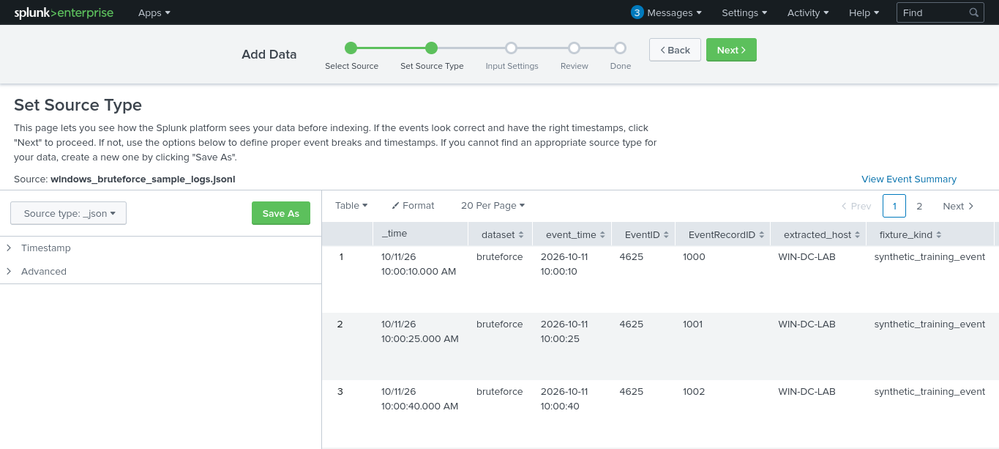
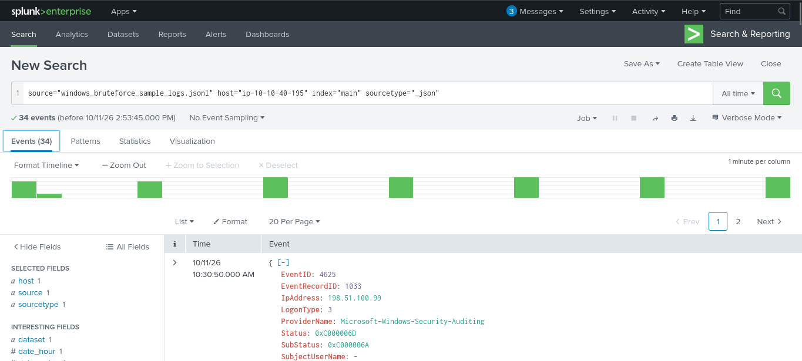
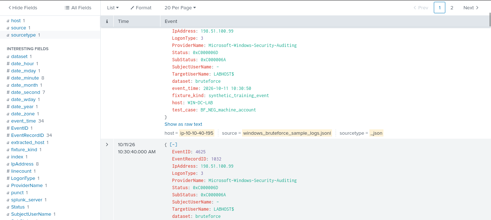
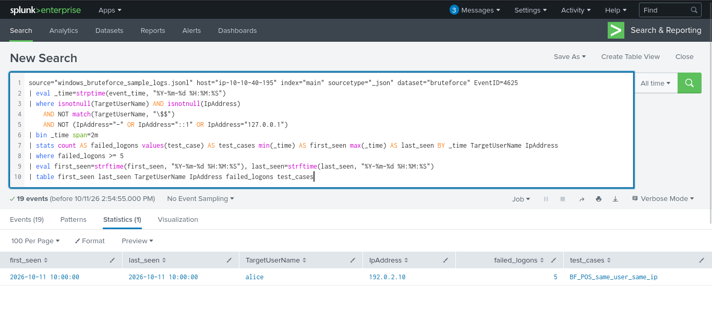
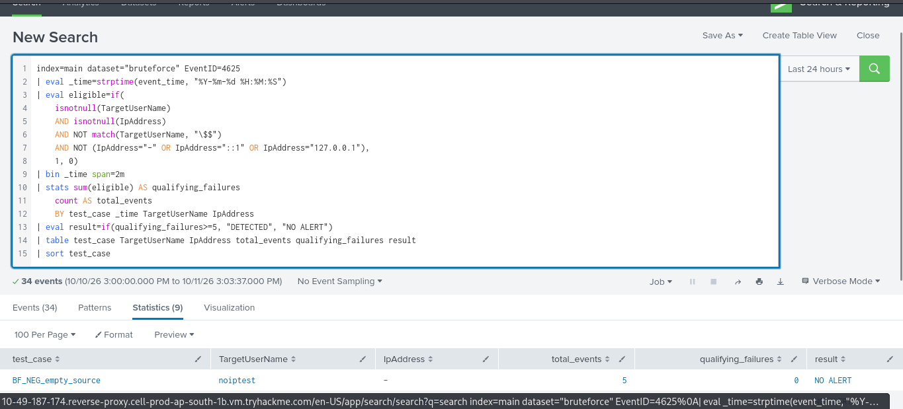
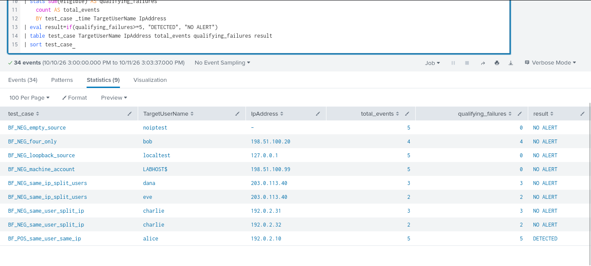

# Rule 01 — Windows Brute-Force Detection with Sigma and Splunk

I built this rule to catch a pattern that can be easy to miss when looking at Windows logs one event at a time: several failed logons against the same account from the same source IP in a short period.

The rule is a starting point for investigation, not proof that an account is under attack. A user mistyping a password or a service using an old password can create a similar pattern.

## 1. Convert the Sigma YAML to Splunk SPL

Sigma rules describe detection logic in a SIEM-independent format. Splunk needs a query in its own Search Processing Language (SPL), so I used **Sigma CLI** with the Splunk backend to translate the rule before testing it.

The source file is:

```text
detections/sigma/Rule_1/windows_brute_force_detected.yml
```

This YAML has two documents in the same file: the `windows_failed_logon` building-block rule and the correlation rule that references it. Keep them together during conversion so Sigma can resolve the reference.

### Set up Sigma CLI

From the root of the repository, create a virtual environment and install the CLI and Splunk backend:

```bash
python3 -m venv .venv
source .venv/bin/activate
python -m pip install sigma-cli
sigma plugin install splunk
```

### Convert the rule

Run:

```bash
sigma convert \
  --target splunk \
  --pipeline splunk_windows \
  -o detections/sigma/Rule_1/windows_brute_force_detected.spl \
  detections/sigma/Rule_1/windows_brute_force_detected.yml
```

The command writes the converted query to `windows_brute_force_detected.spl`. I can inspect it with:

```bash
cat detections/sigma/Rule_1/windows_brute_force_detected.spl
```

The `splunk_windows` pipeline applies Splunk-oriented source and field mappings. If conversion fails, first check that the Splunk backend is installed and that both YAML documents are still present in the input file. Sigma's [CLI documentation](https://github.com/SigmaHQ/sigma-cli) and [correlation documentation](https://sigmahq.io/docs/meta/correlations) describe this conversion workflow and the requirement to provide referenced rules.

**A note about the lab query below:** the sample JSONL fixtures use fields such as `event_time` and `dataset="bruteforce"`. I used a separate SPL query to test those fixtures in Splunk. That manual fixture query is an adaptation of the detection logic; it is not the same thing as the SPL generated by Sigma CLI, which is designed around the selected Windows/Splunk field mappings. I kept that distinction in the write-up rather than treating the two queries as interchangeable.

## 2. What the rule looks for

The YAML contains two related parts:

- **`windows_failed_logon`** matches Windows Security Event ID `4625` (failed logon). It excludes machine accounts ending in `$` and the specified empty or loopback source addresses: `-`, `::1`, and `127.0.0.1`.
- **The correlation rule** groups the remaining events by `TargetUserName` and `IpAddress`. It raises a high-severity alert when a group reaches **five or more failures in two minutes**.

The rule maps to MITRE ATT&CK Credential Access — Brute Force (`T1110`) and Password Guessing (`T1110.001`).

## 3. Lab setup and test data

I used Splunk Enterprise and a small JSONL dataset to check the query logic before trying it with real endpoint logs.

| Item | Value |
|---|---|
| SIEM | Splunk Enterprise |
| Index | `main` |
| Sample file | `windows_bruteforce_sample_logs.jsonl` |
| Dataset field | `bruteforce` |
| Event ID | `4625` |
| Data type | Synthetic training events |
| Test date | 2026-10-11 |

These are **synthetic sample events**, not logs collected from a live Windows computer. They are useful for repeatable logic checks, but they do not demonstrate end-to-end detection on live Windows telemetry.

## 4. Import the JSONL data into Splunk

In Splunk Web, I opened **Settings → Add Data → Upload**, selected `windows_bruteforce_sample_logs.jsonl`, chose `_json` as the source type, and sent it to the `main` index. I then set the time picker to **All time**, because the fixture has its own `event_time` values.

To check that the events arrived and that Splunk could separate the cases, I ran:

```spl
index=main dataset="bruteforce"
| stats count by test_case
```

The useful fields for this test were `event_time`, `EventID`, `TargetUserName`, `IpAddress`, `test_case`, and `dataset`. Checking ingestion first made it easier to distinguish a query issue from a missing-data issue.



## 5. Run the manual SPL query against the fixtures

For the JSONL samples, I ran this query. It reads the fixture timestamp into Splunk's `_time` field, removes the accounts and source addresses excluded by the Sigma logic, and counts the qualifying events by time bucket, username, and IP address.

```spl
index=main dataset="bruteforce" EventID=4625
| eval event_epoch=strptime(event_time, "%Y-%m-%d %H:%M:%S")
| eval _time=event_epoch
| where isnotnull(TargetUserName) AND isnotnull(IpAddress)
    AND NOT like(TargetUserName, "%$")
    AND NOT (IpAddress="-" OR IpAddress="::1" OR IpAddress="127.0.0.1")
| bin _time span=2m
| stats count AS failed_logons
    values(test_case) AS test_cases
    min(event_epoch) AS first_seen
    max(event_epoch) AS last_seen
    BY _time TargetUserName IpAddress
| where failed_logons >= 5
| eval first_seen=strftime(first_seen, "%Y-%m-%d %H:%M:%S")
| eval last_seen=strftime(last_seen, "%Y-%m-%d %H:%M:%S")
| table first_seen last_seen TargetUserName IpAddress failed_logons test_cases
```

The positive test returned the expected group:

- **Username:** `alice`
- **Source IP:** `192.0.2.10`
- **Qualifying failures:** `5`
- **Test case:** `BF_POS_same_user_same_ip`

That result shows the manual SPL found the intended positive scenario in the sample data.



## 6. Check the negative scenarios

I also checked scenarios that should not create a brute-force alert. This matters because a detection that catches the positive example but also alerts on every small cluster of failures is not very useful.

| Test case | Expected behavior | Why |
|---|---|---|
| `BF_POS_same_user_same_ip` | Detect | Five qualifying failures for one username and one IP |
| `BF_NEG_four_only` | No alert | Only four qualifying failures |
| `BF_NEG_same_user_split_ip` | No combined alert | The attempts are split across source IPs |
| `BF_NEG_same_ip_split_users` | No combined alert | The attempts are split across usernames |
| `BF_NEG_loopback_source` | Exclude | Loopback source address is filtered out |
| `BF_NEG_empty_source` | Exclude | Source address is missing or represented by `-` |
| `BF_NEG_machine_account` | Exclude | Account name ends in `$` |

The split-IP and split-user cases are counted separately because the query groups by both `TargetUserName` and `IpAddress`. The expected outcome is not that the events disappear; it is that no individual qualifying group reaches five failures.









Only mark a scenario as passed if the screenshot or actual Splunk result shows that outcome. If a screenshot name is different in the repository, update the corresponding image path here; GitHub paths are case-sensitive.

## 7. What I noticed and what the rule misses

The grouping is important. Without grouping on both the username and source IP, unrelated failed logons could add up to the threshold and create a misleading alert.

There are also a few limitations to keep in mind:

- **Fixed time buckets:** The manual query uses `bin _time span=2m`, which creates fixed two-minute buckets. It is not a rolling 120-second window. Events that straddle a bucket boundary can be missed even if they happened within two minutes of one another.
- **Password spraying:** The rule may miss an attempt that targets many usernames with only one or two failures per account.
- **Distributed attempts:** Failures from several source IPs against the same account are counted in separate groups.
- **No success correlation:** The rule does not check whether a successful logon (Event ID `4624`) follows the failures.
- **Possible false positives:** A user repeatedly mistyping a password, an application using an outdated password, or a misconfigured service can generate repeated failures.
- **Field mapping matters:** Real Windows Security events need to be ingested with the username and source-IP fields mapped correctly. The synthetic data already has these fields, but real data should be checked before relying on the rule.

## 8. Result and next steps

The positive synthetic scenario returned five failed logons for `alice` from `192.0.2.10`. That is the result I expected from the manual SPL test. The negative cases should be recorded individually based on their observed Splunk results.

This is a fixture-based test of the manual SPL logic. The converted `.spl` file should be reviewed separately, then tested against the event format actually used in the Splunk index. To complete the end-to-end validation, the next step is to collect genuine Windows Security Event ID `4625` telemetry in a controlled lab, confirm field mappings, and test the converted query against those events.

## Key takeaway

This exercise helped me see why brute-force detection is about a pattern rather than one failed login. It also showed me that converting Sigma to SPL is only one part of the job: I still need to confirm that the query matches the fields in the dataset, test cases that should not alert, and document the limitations honestly.
