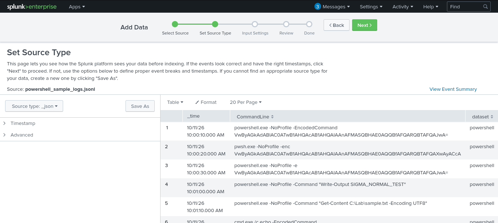
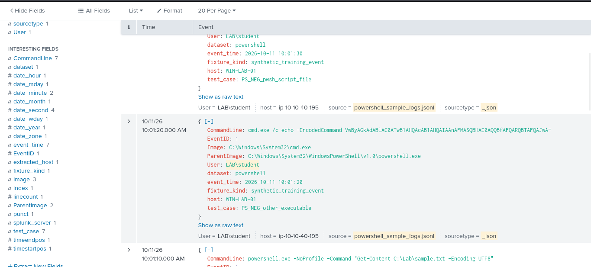
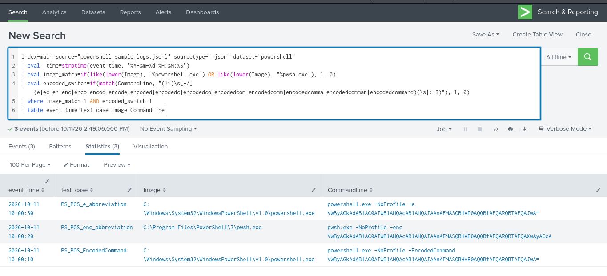
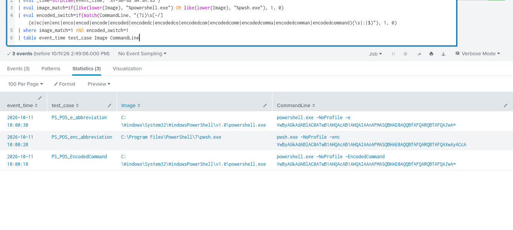
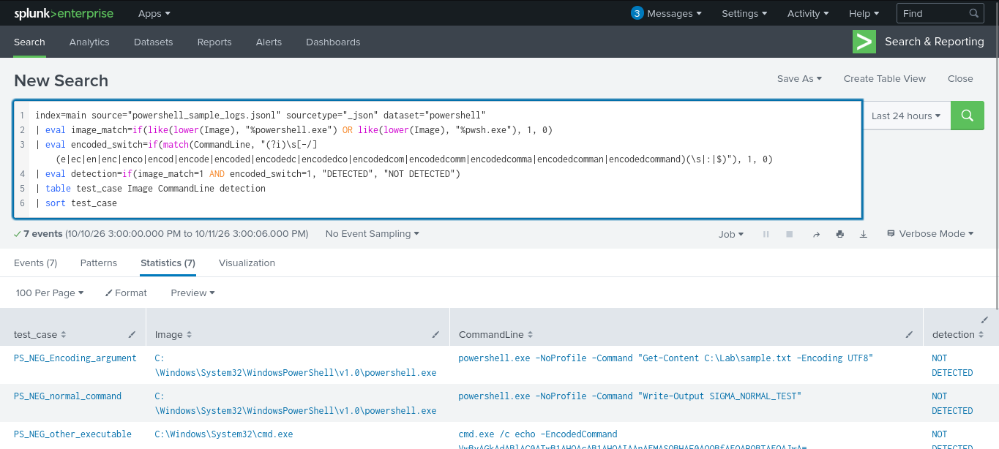
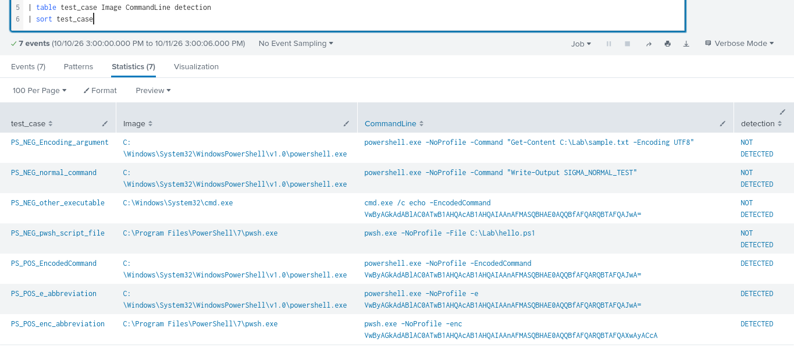

# Suspicious PowerShell Detection — Sigma Rule

I made this rule to catch PowerShell processes started with an encoded command. Encoding by itself does not mean something is malicious, but it can hide what a command is doing, so I wanted the rule to flag it for a closer look.

**Rule file:** `Suspicious_Powershell_Command_Execution.yml`  
**Severity:** Medium  
**MITRE ATT&CK:** [T1059.001 — PowerShell](https://attack.mitre.org/techniques/T1059/001/), [T1027 — Obfuscated Files or Information](https://attack.mitre.org/techniques/T1027/)

## 1. Converting the Sigma YAML to Splunk SPL

Before testing the detection in Splunk, the YAML rule needs to be translated into Splunk's Search Processing Language (SPL). Sigma CLI handles that conversion through its Splunk backend.

From the root of the `cybersec-portfolio` repository, set up the tools in a virtual environment:

```bash
python3 -m venv .venv-sigma
source .venv-sigma/bin/activate
python -m pip install --upgrade pip
python -m pip install sigma-cli
sigma plugin install splunk
```

With the Splunk backend installed, convert the original YAML rule:

```bash
sigma convert \
  --target splunk \
  --pipeline splunk_windows \
  -o detections/sigma/Rule_2/Suspicious_Powershell_Command_Execution.spl \
  detections/sigma/Rule_2/Suspicious_Powershell_Command_Execution.yml
```

The command writes the converted query to `Suspicious_Powershell_Command_Execution.spl`. Review that output before using it against real Windows telemetry, because field names and source conditions have to match the logs being searched. The `splunk_windows` pipeline provides Windows-specific mapping; the right pipeline and field mapping still depend on whether the events come from Sysmon, Windows Security auditing, or another source.

**Important distinction about this test:** the screenshots below show a manually written SPL query used to test the rule's logic against the supplied synthetic JSON fixtures. That query is not being presented as the exact output of the Sigma converter. Keep the CLI-generated `.spl` separate from the fixture-testing query and compare them before claiming that the converted query has been validated.

## 2. What the rule looks for

The rule uses the `process_creation` log source for Windows. It looks for both of these conditions in the same event:

- `Image` ends with `powershell.exe` or `pwsh.exe`.
- `CommandLine` contains an encoded-command switch, such as `-EncodedCommand`, `-enc`, or `-e`.

Both conditions matter. A PowerShell process running a normal command should not trigger this rule, and a different executable containing the same text should not trigger it either.

The rule also checks for abbreviated forms of the encoded-command switch. PowerShell accepts several unambiguous prefixes of `-EncodedCommand`, so matching only the full switch would miss some valid cases. The regex uses a boundary after the switch to avoid treating `-Encoding` as an encoded-command flag.

## 3. Log source and test data

For this test I imported `powershell_sample_logs.jsonl` into Splunk Enterprise, using the `_json` sourcetype and the `main` index. The events are synthetic training fixtures, not logs collected from a real Windows endpoint. Each event includes fields such as `event_time`, `test_case`, `Image`, and `CommandLine` so the rule's matching logic can be checked consistently.



After import, I checked the parsed events and their fields in Splunk. This helped confirm that the command line and executable path were available for the search.



## 4. Testing the detection in Splunk

I ran a SPL query against the synthetic events. It checks the executable path first, then looks for the encoded-command switch in `CommandLine`.

The core matching logic was:

```spl
| eval image_match=if(
    like(lower(Image), "%powershell.exe") OR like(lower(Image), "%pwsh.exe"),
    1, 0
)
| eval encoded_switch=if(
    match(CommandLine, "(?i)\s[-/](e|ec|en|enc|enco|encod|encode|encoded|encodedc|encodedco|encodedcom|encodedcomm|encodedcomma|encodedcomman|encodedcommand)(\s|:|$)"),
    1, 0
)
| where image_match=1 AND encoded_switch=1
| table event_time test_case Image CommandLine
```

I kept the dataset, source, and sourcetype filters in the full Splunk search so that the query only worked on the uploaded PowerShell fixtures. The time selector was set to **All time** because the search uses the fixture's `event_time` field.

The positive search returned three events: the full `-EncodedCommand` switch, the `-enc` abbreviation, and the `-e` abbreviation. The result table shows the matching executable path and command line for each event.



This view shows the matching rows and the command lines returned by the search.



## 5. Positive and negative test cases

I also ran a version of the query that labels every fixture as `DETECTED` or `NOT DETECTED`. This made it easier to check whether the rule matched only the cases it was meant to catch.

| Test case | Expected result | Observed result |
|---|---|---|
| `PS_POS_EncodedCommand` | Detected | Detected |
| `PS_POS_enc_abbreviation` | Detected | Detected |
| `PS_POS_e_abbreviation` | Detected | Detected |
| `PS_NEG_normal_command` | Not detected | Not detected |
| `PS_NEG_Encoding_argument` | Not detected | Not detected |
| `PS_NEG_other_executable` | Not detected | Not detected |
| `PS_NEG_pwsh_script_file` | Not detected | Not detected |

The negative cases are important. In particular, the `-Encoding` example checks that the regex does not confuse a normal PowerShell parameter with `-EncodedCommand`. The `cmd.exe` example checks that seeing the text `-EncodedCommand` is not enough unless the executable also matches.



The complete result table shows all seven synthetic cases, with three detections and four non-detections.



## 6. Results and limitations

The manual SPL query behaved as expected against the seven supplied fixtures: **3 positive cases were detected and 4 negative cases were not detected**. This confirms the matching logic for these sample events, but it does not prove the detection works against real endpoint telemetry.

There are a few things to keep in mind before deploying it:

- The event source must record process creation and the full command line. This can be provided by Sysmon Event ID 1 or Windows Security Event ID 4688 when command-line auditing is enabled.
- An encoded command can be used for legitimate administration and automation. The alert is a reason to investigate, not proof of an attack.
- The rule may miss PowerShell copied or renamed to another executable name, and it does not cover every other form of PowerShell obfuscation.
- Synthetic JSON fields may not map directly to a real Splunk Windows event. The generated Sigma SPL must be reviewed against the actual source and field names.

## 7. What I learned

The main lesson for me was that a useful detection needs to be tested against both matching and non-matching examples. It is easy to make a rule that catches the obvious encoded command, but the negative tests are what help show whether the rule is too broad. I also kept the Sigma conversion step separate from the hand-written fixture query so it's clear which query came from the converter and which one I used to check the sample data.

**Current validation status:** manual SPL tested against synthetic fixtures. Testing against live Windows events and confirming the behavior of the Sigma-CLI-generated SPL remain separate validation steps.
