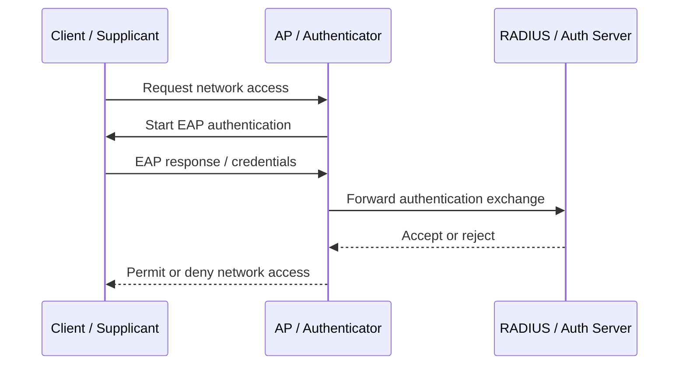

# Securing Wireless and Mobile Devices

**CompTIA Security+ SY0-701 | Domain 4: Security Operations**

## 1. Wireless site surveys

A **site survey** assesses the radio-frequency environment before deploying or troubleshooting a wireless network. It helps identify existing access points (APs), channel and frequency use, signal coverage, interference, and physical areas with weak or excessive coverage.

A survey can include:
- Discovering APs managed by the organization and nearby APs outside its control.
- Sampling the wireless spectrum and checking channel congestion.
- Measuring signal strength and roaming behavior across locations.
- Producing a **heat map** that visualizes signal strength or coverage.
- Repeating measurements after changes to walls, furniture, AP placement, or neighboring networks.

Wireless survey tools can include built-in operating-system tools, AP-management consoles, third-party survey applications, and a **spectrum analyzer**. A spectrum analyzer shows radio activity across a frequency range and can help identify interference from Wi-Fi and non-Wi-Fi sources. Coverage and interference can change, so surveys are not necessarily a one-time task.

## 2. Mobile device management

**Mobile Device Management (MDM)** is centralized administration of mobile devices. An organization can use it to enforce configuration and security policies, inventory devices, manage applications, control access, and remotely lock or erase supported devices.

Typical MDM capabilities include:
- Applying passcode, encryption, screen-lock, and OS-version requirements.
- Managing approved applications and restricting risky installation sources.
- Configuring Wi-Fi, VPN, certificates, email, and other work services.
- Separating company information from personal information.
- Removing corporate data when a device is lost or an employee leaves.
- Checking device compliance before allowing access to business systems.
- Restricting device features such as camera use, screen capture, or file transfer where the platform and management policy support those controls.

Remote-wipe behavior depends on the platform and whether the device is personally or organization-owned. Policies should define what may be erased and who can authorize it.

### BYOD and COPE

| Model | Meaning | Advantages | Risks / considerations |
|---|---|---|---|
| **BYOD** | Bring Your Own Device; employee-owned device used for work | Familiar device; less hardware purchasing for the organization | Personal privacy, ownership, support, data separation, and remote-wipe concerns |
| **COPE** | Corporate-Owned, Personally Enabled; company-owned device can also be used personally | Organization has stronger control over hardware, policy, and security configuration | More cost and administration; clear boundaries are still needed between work and personal use |
| **CYOD** | Choose Your Own Device from an approved set | Balances user choice and standardization | Requires an approved device catalogue and support plan |

A good mobile-device policy describes acceptable use, required controls, monitoring, privacy boundaries, data ownership, incident reporting, and what happens on loss, theft, termination, or policy violation.

## 3. Cellular, Wi-Fi, and Bluetooth risks

### Cellular networks
Cellular networks divide geographic areas into **cells**, each served by network radio equipment. A device can move between cells as it travels, using supported radio frequencies and handoff procedures. Because cellular devices are highly mobile and stay connected across locations, traffic and connection metadata can reveal movement patterns. Depending on the service and permissions, location, login, traffic, and device-ownership information may be monitored. Location-based signals can be inaccurate, so they should be interpreted with other evidence.

### Wi-Fi
Wireless risks include:
- Unauthorized access points and rogue APs.
- Eavesdropping on unprotected traffic.
- On-path (man-in-the-middle) attacks.
- Denial-of-service and radio-frequency interference.
- Weak passwords or insecure public hotspots.

Use modern wireless security, unique strong credentials, and end-to-end application encryption. Treat public Wi-Fi as untrusted; use HTTPS and an organization-approved VPN when appropriate. A VPN protects traffic to its endpoint, but it does not make a malicious website or compromised device safe.

### Bluetooth
Bluetooth is a short-range wireless technology used for peripherals and other devices. Bluetooth also supports personal-area networking uses. Security risks include unsafe pairing, unexpected connections, and devices left discoverable unnecessarily.

- Pair devices only when there is a legitimate reason.
- Confirm the correct device and pairing prompt.
- Remove old pairings and disable unused Bluetooth functionality.
- Keep firmware and operating systems updated.
- Avoid accepting unknown pairing requests.

## 4. Wireless authentication and encryption

### Wireless security modes

| Mode | Authentication and protection | Main security consideration |
|---|---|---|
| **Open System / Open network** | No user authentication at the wireless layer; open networks generally do not provide Wi-Fi link-layer encryption. | Traffic may be observable on the local radio link unless another protection layer, such as HTTPS or a VPN, is used. |
| **WPA2-Personal (PSK)** | Devices use a shared pre-shared passphrase; protected traffic commonly uses AES-CCMP. | A captured authentication handshake can be used to test passphrase guesses offline, so weak or reused passphrases are risky. |
| **WPA3-Personal (SAE)** | Uses a password-authenticated key exchange based on the Dragonfly handshake and derives session keys. | Improves protection against passive offline guessing and provides mutual authentication, but does not remove the need for a strong password and secure implementation. |
| **WPA3-Enterprise (802.1X/EAP)** | Authenticates users or devices individually through an enterprise authentication system, commonly RADIUS. | Provides individual credentials and centralized access control rather than a single shared PSK. |

### Pre-shared keys
A **Pre-Shared Key (PSK)** is a shared credential used to join a wireless network. It is common in small or home environments, but all users share the same credential, making revocation and accountability difficult. A long, unique passphrase and periodic review of authorized users are important.

With WPA2-Personal, an attacker who captures the relevant handshake can test guesses offline. This makes weak, common, or reused passphrases risky. Strong passphrases make guessing substantially more difficult. Capturing a handshake does not automatically reveal the password.

### WPA3, SAE, and the Dragonfly handshake
**WPA3-Personal** uses **Simultaneous Authentication of Equals (SAE)**, a password-authenticated key-exchange method based on the Dragonfly design. SAE provides mutual authentication and derives session keys without transmitting the Wi-Fi password as a reusable secret. It is designed to make passive capture of an exchange insufficient for ordinary offline dictionary testing of candidate passwords.

SAE does not eliminate every risk. Weak credentials can still be guessed through other avenues, and implementation flaws, obsolete devices, or poor configuration can create exposure. Keep devices updated and use the strongest compatible mode. Evaluate WPA2/WPA3 transition configurations for compatibility and security rather than assuming they provide every benefit of pure WPA3.

### GCMP and message integrity

**GCMP (Galois/Counter Mode Protocol)** is an authenticated-encryption cipher suite used in some modern IEEE 802.11 security profiles. It protects confidentiality and integrity of protected wireless frames. GCMP-128 and GCMP-256 are different security-strength options; the actual cipher depends on the wireless mode, negotiated suite, access point, and client capabilities. Do not assume every WPA3 connection uses GCMP-256.

Wireless protection should provide both **confidentiality** (preventing unauthorized reading of frames) and **integrity** (detecting unauthorized modification). Use only authorized access, enable encryption, and prefer secure authentication; integrity protection does not replace secure application protocols or endpoint security.

### WPA3-Enterprise and IEEE 802.1X
Enterprise wireless commonly uses **IEEE 802.1X** and an authentication server, often RADIUS, to authenticate each user or device rather than relying on one shared PSK.

The main roles are:
- **Supplicant:** the client requesting network access.
- **Authenticator:** the AP or switch that controls access to the network.
- **Authentication server:** validates the supplied credentials or certificates, often using RADIUS.

**EAP (Extensible Authentication Protocol)** is a framework supporting multiple authentication methods; it is not a single authentication algorithm.

## 5. RADIUS and AAA

**AAA** means:
- **Authentication:** who are you?
- **Authorization:** what are you allowed to do?
- **Accounting:** what did you do, and when?

**RADIUS (Remote Authentication Dial-In User Service)** centralizes authentication, authorization, and accounting for network access, including enterprise Wi-Fi, VPNs, and some remote-access services. It reduces the need to maintain separate local accounts on every network device. RADIUS availability, secure transport/configuration, shared-secret management, logging, and redundancy matter.

## Secure wireless checklist

1. Use WPA3 when supported and compatible; otherwise use a securely configured WPA2 mode.
2. Prefer WPA3-Enterprise/802.1X for managed enterprise access.
3. Use a unique strong passphrase for PSK networks.
4. Review APs, coverage, interference, and rogue-device alerts.
5. Update AP and client firmware.
6. Disable unneeded services and unsafe pairing/discovery.
7. Use MDM compliance checks for managed mobile devices.
8. Treat public Wi-Fi as untrusted and protect application traffic with HTTPS/VPN as appropriate.

## Further reading
- [Professor Messer — Securing Wireless and Mobile](https://www.professormesser.com/security-plus/sy0-701/sy0-701-video/securing-wireless-and-mobile-sy0-701/)
- [Professor Messer — Wireless Security Settings](https://www.professormesser.com/security-plus/sy0-701/sy0-701-video/wireless-security-settings-sy0-701/)
- [Cisco — WPA3 security enhancements and GCMP cipher options](https://www.cisco.com/c/en/us/td/docs/wireless/controller/9800/26-1/configuration-guide/wl-26-1-cg/securityenhancements-for-access-points/info-about-wifi7-ap-wpa3-security-enhancements.html)
- [Professor Messer — SY0-701 course index](https://www.professormesser.com/security-plus/sy0-701/sy0-701-video/sy0-701-comptia-security-plus-course/)
- [NIST Digital Identity Guidelines](https://pages.nist.gov/800-63-4/)
