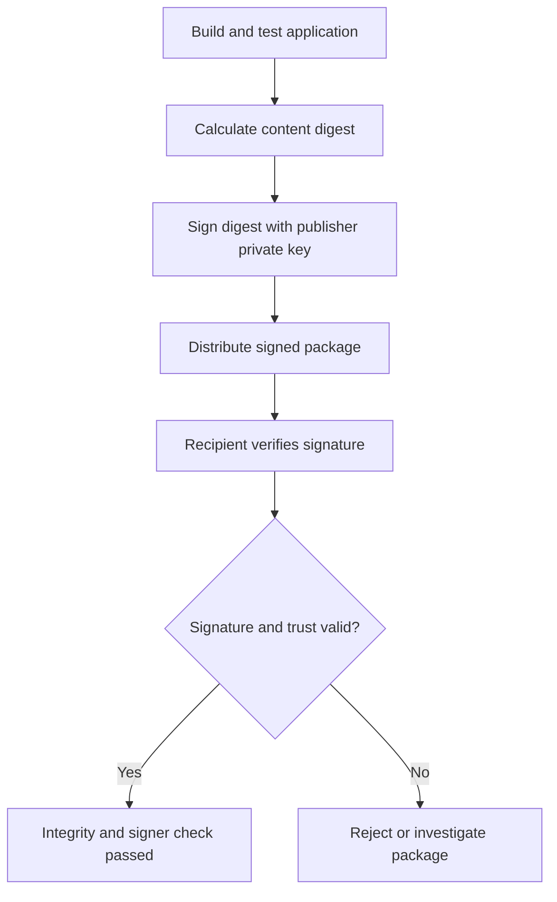
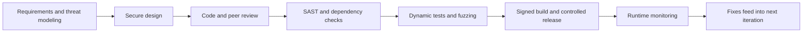

# Application Security

**CompTIA Security+ SY0-701 | Domain 4: Security Operations**

Application security aims to reduce defects and weaknesses in software design, development, testing, deployment, and operation. Security can compete with delivery speed or convenience if it is treated as an afterthought; the goal is to integrate appropriate security into the development lifecycle rather than postpone it until release.

## 1. Input validation and normalization

**Input validation** checks whether data has the expected type, structure, length, range, and meaning before an application uses it.

Good practices:
- Define expected input and reject input that violates the rules.
- Validate on the server, even if the client also validates.
- Use allowlists where the expected input can be described precisely.
- Normalize input consistently before validation where relevant.
- Avoid relying only on blacklists of known-bad strings.
- Use parameterized queries for database input, context-aware output encoding, and safe APIs; validation alone is not a replacement for these protections.
- Test unusual boundary values, encodings, and unexpected combinations.

**Fuzzing** supplies many unexpected or semi-random inputs to discover crashes, hangs, parsing bugs, and unexpected behavior. It complements code review and testing; it does not prove an application is vulnerability-free.

## 2. Secure cookies and sessions

Cookies can support tracking, personalization, and session management. A session cookie may be valuable to an attacker because theft can allow impersonation. Avoid storing passwords, access secrets, or unnecessary sensitive data directly in cookies.

For a browser session cookie:
- `Secure` restricts sending the cookie to secure HTTPS connections.
- `HttpOnly` prevents ordinary client-side JavaScript from reading the cookie.
- `SameSite` helps control when browsers attach cookies to cross-site requests.
- Use unpredictable session identifiers and regenerate them after authentication or privilege changes.
- Expire and invalidate sessions on logout, timeout, and important security events.
- Protect the entire authenticated session with HTTPS, not just the login page.

Cookie attributes reduce risk but do not independently prevent every cross-site scripting, cross-site request forgery, or session-hijacking attack.

## 3. Static code analysis

**Static Application Security Testing (SAST)** examines source code, bytecode, or another representation without executing the application. It can find patterns such as unsafe functions, injection risks, insecure cryptographic calls, and some data-flow problems early in development.

Advantages:
- Can be integrated into developer workflows and continuous integration.
- Can find many defects before deployment.
- Can point developers toward affected code.

Limitations:
- Results can include false positives and false negatives.
- Some findings require human verification.
- Static analysis may not reveal runtime configuration errors or all cryptographic design flaws.
- A clean scan does not guarantee the application is secure.

## 4. Code signing and software integrity

Code signing helps establish that software came from a signer and has not changed since it was signed, assuming the signing key and validation process are trustworthy.

A simplified process:
1. The publisher calculates a cryptographic digest of the software.
2. The publisher signs the digest using a private signing key.
3. The recipient or operating system validates the signature with the corresponding public key and validates the publisher's certificate or trust chain.
4. The signature check detects changes to the signed content.

A trusted Certificate Authority (CA) may issue or validate a certificate binding the publisher's identity to a public key. The CA does not normally sign every application package on behalf of the developer; the publisher signs the release with the publisher-controlled code-signing key.

Code signing is useful, but a valid signature does not mean the application is harmless. A legitimate publisher can ship vulnerable software, and an attacker may steal a signing key.

## 5. Sandboxing

A **sandbox** restricts an application's access to the wider operating system and other resources. It can limit filesystem access, system calls, device access, network behavior, or communication with other apps.

Sandboxes can be used by:
- Browsers to isolate web content.
- Mobile operating systems to isolate applications.
- Virtual machines and containers to separate workloads.
- Windows and other platforms to constrain app behavior.

Sandboxing reduces the impact of compromise; it is not an absolute barrier. Misconfigurations, escape vulnerabilities, excessive privileges, or shared-resource weaknesses may undermine isolation.

## 6. Application security monitoring

Runtime application security monitoring collects and analyzes application behavior, access events, errors, blocked attacks, and other telemetry. It can reveal anomalies, attacks, or misuse that testing did not detect.

A monitoring program should:
- Collect useful events while avoiding unnecessary sensitive data.
- Centralize logs and correlate related activity.
- Alert on suspicious events and preserve evidence.
- Track false positives and tune detections.
- Feed investigation outcomes into testing and secure development.

## Practical development workflow

## Further reading
- [Professor Messer — Application Security](https://www.professormesser.com/security-plus/sy0-701/sy0-701-video/application-security-sy0-701/)
- [OWASP Cheat Sheet Series](https://cheatsheetseries.owasp.org/)
- [OWASP Session Management Cheat Sheet](https://cheatsheetseries.owasp.org/cheatsheets/Session_Management_Cheat_Sheet.html)
- [OWASP Authentication Cheat Sheet](https://cheatsheetseries.owasp.org/cheatsheets/Authentication_Cheat_Sheet.html)
