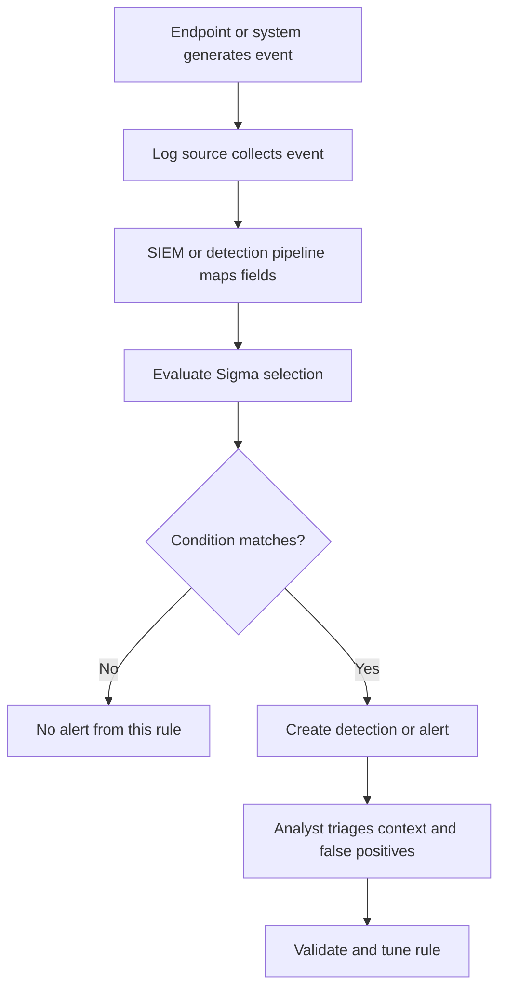

# Sigma Rules

**CompTIA Security+ SY0-701 | Detection and monitoring**

## What is Sigma?

**Sigma** is an open, vendor-agnostic format for describing detections from log events. A rule expresses what activity is suspicious and what conditions should trigger a match. Sigma rules can be converted into queries or detections supported by SIEM and log-analysis products, subject to the target platform's field names and capabilities.

A Sigma rule is not itself a SIEM, a log source, or a guarantee that an attack will be detected. It describes a detection that must be mapped to the available telemetry and tested in the target environment.

## Common rule fields

| Field | Purpose |
|---|---|
| `title` | Short name that communicates what the rule detects |
| `id` | Unique rule identifier, commonly a UUID |
| `status` | Maturity or review status, such as experimental or stable |
| `description` | Explanation of the behavior and why it matters |
| `references` | Links to relevant advisories, research, or documentation |
| `author` | Rule author or maintainer |
| `date` / `modified` | Creation and modification dates |
| `logsource` | Describes the product, service, and/or event category needed |
| `detection` | Defines selections and the condition that combines them |
| `falsepositives` | Known benign reasons a rule may match |
| `level` | Severity such as low, medium, high, or critical |
| `tags` | Searchable classifications, commonly including ATT&CK mappings |

Rules may include additional fields, and some fields are optional under the Sigma specification. The target backend must have the required events and equivalent field mappings.

## The `logsource` section

`logsource` states where relevant events originate. It may identify:
- `product`, for example Windows.
- `category`, for example process creation.
- `service`, for example a particular log service.
- `definition`, additional context needed to interpret the source.

Selecting the right log source is essential. A process-creation rule cannot work if the environment does not collect process-creation events.

## The `detection` section

The `detection` section contains one or more named selections and a `condition` describing how those selections must match. A selection can test a field for a value or pattern. Modifiers can express comparisons such as case-insensitive matching or suffix matching, depending on the specification.

### Example: detecting a suspicious command-line utility

This generic example is for teaching the structure. It does not by itself establish that every execution of the utility is malicious.

```yaml
title: Example Suspicious Utility Execution
id: 7f4083a7-9b3c-4c41-91c0-34c6e889fa40
status: experimental
description: Detects a utility execution pattern that should be reviewed in context.
author: Security Analyst
date: 2026-10-11
logsource:
    product: windows
    category: process_creation
detection:
    selection:
        Image|endswith: '\exampletool.exe'
    condition: selection
falsepositives:
    - Approved administrative activity
level: medium
tags:
    - attack.execution
```

Before use, validate that the field (`Image` here) exists in the chosen event source and that the filename/path logic matches the environment. Production rules normally use reviewed identifiers, accurate references, log-source mappings, and tested false-positive notes rather than generic placeholders.

## How a Sigma detection works



## Testing and maintaining rules

1. Confirm that the relevant event source is enabled and producing logs.
2. Validate the YAML syntax and rule schema.
3. Convert the rule to the intended SIEM query or backend format.
4. Test it with representative benign and suspicious events.
5. Document expected false positives.
6. Use an appropriate severity and escalation path.
7. Track changes, version the rule, and review it as software, log schemas, and attacker behavior evolve.

## Further reading
- [Official Sigma specification](https://github.com/SigmaHQ/sigma-specification)
- [Sigma rule specification](https://github.com/SigmaHQ/sigma-specification/blob/main/specification/sigma-rules-specification.md)
- [Official Sigma rule repository](https://github.com/SigmaHQ/sigma)
