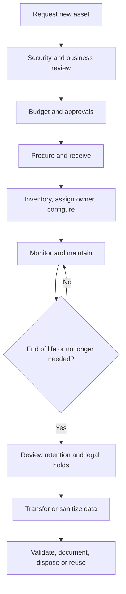

# Asset Management

**CompTIA Security+ SY0-701 | Domain 4: Security Operations**

Asset management tracks the lifecycle, ownership, use, support, classification, and disposal of an organization's hardware, software, information, and services. Security teams need a reliable inventory to know what must be protected, patched, monitored, backed up, and retired.

## 1. Acquisition and procurement

Procurement is usually a multi-step process:
1. A user or team identifies a hardware/software requirement.
2. IT confirms technical fit, supportability, and security requirements.
3. Budget owners review cost and funding.
4. Purchasing and management obtain the required approvals.
5. The organization compares suppliers and negotiates terms.
6. The purchase or service contract is finalized.
7. The item is received, checked, recorded, and assigned.

Approval and supplier due diligence help prevent unsupported products, unplanned recurring costs, untrusted components, and purchases that do not meet security policy.

## 2. Asset assignment and accounting

A central asset-tracking system should record information such as:
- Asset identifier, type, manufacturer, model, and serial number.
- Assigned owner or responsible team.
- Purchase date, warranty, lifecycle state, and location.
- Operating system, software versions, CPU, memory, storage, and network identifiers where useful.
- Support tickets, changes, and maintenance history.
- Data classification and security requirements.

Ownership does not necessarily mean the owner performs all changes. A user may be accountable for a laptop while IT administers it. Clear ownership helps determine who receives updates, who approves use, and who is contacted during a security incident.

Hardware may be treated as a capital expense, while software subscriptions and licensing may be operating expenses. Exact accounting and depreciation rules depend on the applicable accounting framework and contract; the security inventory should still track the asset regardless of accounting treatment.

## 3. Monitoring and asset tracking

Organizations may use:
- Barcode labels and RFID tags.
- Asset inventory agents and device-management tools.
- Purchase records, support tickets, and assigned owners.
- Network discovery and endpoint-management data.
- Physical inspections and reconciliation.

A useful inventory is kept current rather than created only once. Changes to ownership, location, role, software, or support status should be reflected in the inventory.

## 4. Media sanitization and disposal

Before reusing, selling, donating, or disposing of storage media, determine whether its data must be retained, transferred, sanitized, or destroyed.

Important distinctions:
- **Clear:** apply logical techniques intended to make data inaccessible through ordinary interfaces.
- **Purge:** use a stronger technique intended to make recovery infeasible for the relevant level of effort.
- **Destroy:** physically destroy the media when required by sensitivity, policy, or technical limitations.

The correct method depends on media type, data sensitivity, reuse plans, and the organization's approved sanitization standard. Overwriting every sector is not a universal guarantee for every storage technology, especially when remapped or inaccessible areas may exist. Cryptographic erase may be appropriate for eligible encrypted media when implementation and key management are trustworthy. Sanitization should be documented and validated.

Physical destruction can include approved shredding or other media-appropriate methods. Degaussing works only for applicable magnetic media; it is not a general solution for all solid-state storage.

## 5. Cost and data retention

Asset disposal is not only a cost decision. Organizations should consider:
- Legal and contractual retention requirements.
- Backups and archival copies.
- Cost of continued storage and maintenance.
- Risk of data exposure.
- Operational need to recover information.
- Evidence preservation and legal holds.

A defensible disposal process records the asset, authorization, sanitization method, validation outcome, date, and responsible party.

## Further reading
- [Professor Messer — Asset Management](https://www.professormesser.com/security-plus/sy0-701/sy0-701-video/asset-management-sy0-701/)
- [NIST SP 800-88 Rev. 2 — Guidelines for Media Sanitization](https://csrc.nist.gov/pubs/sp/800/88/r2/final)
