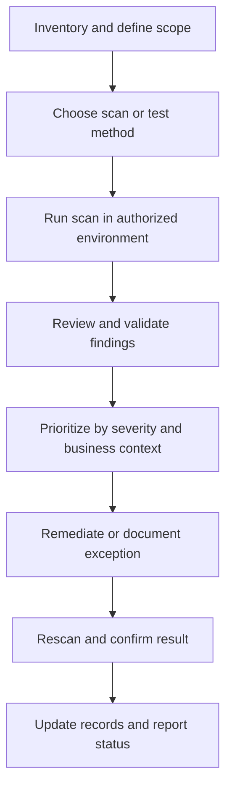

# Vulnerability Scanning and Package Monitoring

**CompTIA Security+ SY0-701 | Domain 4: Security Operations**

Vulnerability scanning and software testing look for known or potential security weaknesses. Different techniques examine different evidence; a single tool or scan cannot find every defect.

## 1. Vulnerability scanning

A vulnerability scanner compares observed systems, services, software, and configurations against known issues or security checks. It can help identify:
- Missing patches and unsupported versions.
- Exposed ports and services.
- Weak configurations or default settings.
- Known software vulnerabilities.
- Differences from a security baseline.

Scans may be performed from inside the network, from outside, against hosts, network devices, web applications, or cloud assets. Internal and external results can differ because they see different attack surfaces. Scanners need current vulnerability content and accurate asset identification.

A scan result is an indicator requiring validation. **False positives** report a problem that is not present; **false negatives** miss a real problem. Authentication, scan coverage, network filtering, asset identification, and signatures affect accuracy.

## 2. Static Application Security Testing (SAST)

SAST analyzes source code or compiled representations without running the application. It can quickly find patterns such as dangerous input handling, unsafe API use, and potential injection paths. Results often need manual review; some flaws depend on runtime configuration, cryptographic design, or interactions that static analysis cannot fully model.

## 3. Dynamic analysis and fuzzing

Dynamic analysis tests a running program. Methods include:
- Supplying unexpected, malformed, or boundary-value input.
- **Fuzzing:** automating large numbers of input variations.
- Fault injection or robustness testing.
- Monitoring errors, crashes, hangs, exceptions, and unexpected responses.

Fuzzing is valuable for discovering parsing errors and unexpected code paths, but requires suitable test conditions and can consume substantial time and resources. Test safely in a controlled environment; do not fuzz systems without authorization.

## 4. Package and dependency monitoring

Applications often include packages, libraries, and dependencies. A vulnerable or compromised dependency can introduce risk even if application code itself appears correct.

Controls include:
- Use trusted and approved repositories.
- Verify digital signatures or integrity hashes when available.
- Maintain a software bill of materials (SBOM) when appropriate.
- Monitor vulnerability advisories and dependency versions.
- Review package provenance and maintainers.
- Test updates before production deployment where risk warrants it.
- Record and remediate exceptions.

An open-source package is not automatically unsafe, but public availability does not itself guarantee security. A signed package proves something about its integrity and signer, not that it is free of vulnerabilities.

## Suggested workflow

## Further reading
- [Professor Messer — Vulnerability Scanning](https://www.professormesser.com/security-plus/sy0-701/sy0-701-video/vulnerability-scanning-sy0-701/)
- [NIST SP 800-115 — Technical Guide to Information Security Testing and Assessment](https://csrc.nist.gov/pubs/sp/800/115/final)
- [NIST National Vulnerability Database](https://nvd.nist.gov/)
