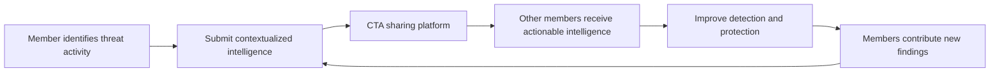
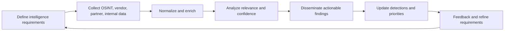

# Threat Intelligence

**CompTIA Security+ SY0-701 | Domain 4: Security Operations**

Threat intelligence is researched, analyzed information about threats, threat actors, capabilities, indicators, vulnerabilities, and likely attack behavior. Its purpose is to support decisions: what to prevent, monitor, investigate, or prioritize.

Threat intelligence should be relevant to the organization and actionable. Large amounts of raw data are not useful if they are not analyzed, contextualized, and delivered to the people who need them.

## 1. Open-source intelligence (OSINT)

**OSINT** is intelligence derived from publicly available sources. Examples include:
- Security advisories and vulnerability databases.
- Public reports, blogs, mailing lists, and social media.
- Public breach and malware analyses.
- Publicly available registration, infrastructure, or domain information.
- Reports from researchers and security vendors.

OSINT can be timely and inexpensive, but sources can be incomplete, misleading, outdated, or deliberately manipulated. Validate important claims and record confidence and provenance.

## 2. Proprietary and hybrid intelligence

Commercial or proprietary intelligence services may aggregate data from many sources, correlate observations, perform analysis, and provide curated feeds or reports. Benefits can include dedicated research, update services, and analysis at scale. Limitations include subscription cost, coverage differences, and varying quality.

A hybrid approach combines public sources, internal telemetry, commercial feeds, and the organization's own investigation results.

## 3. Information-sharing organizations

Organizations may share threat information through industry groups, trusted communities, government partnerships, or **Information Sharing and Analysis Centers (ISACs)**. Shared material may include indicators of compromise, attack techniques, vulnerability reports, and recommended mitigations.

Useful sharing requires context, a consistent format, protection of sensitive information, and rules describing how the information may be reused.

### Cyber Threat Alliance (CTA) example

The **Cyber Threat Alliance (CTA)** is a membership organization that enables cybersecurity providers to share timely, actionable, and contextualized threat intelligence. Members contribute structured information and receive useful intelligence from other members, helping them improve detections and defensive products. Sharing works best when indicators include context, submission provenance, and enough detail to support action.

## 4. Dark-web intelligence

Dark-web services are not indexed and accessed like ordinary public websites and often require specialized software or specific access mechanisms. Relevant intelligence may concern stolen credentials, payment-card data, account sales, criminal services, leaked data, or attacker discussions.

Collection and monitoring can be difficult and legally sensitive. Organizations should use authorized processes and should not treat every forum post or offer as authentic.

## 5. From intelligence to action

A practical intelligence lifecycle includes:
1. **Direction:** define questions and intelligence requirements.
2. **Collection:** gather relevant public, commercial, partner, and internal data.
3. **Processing:** normalize, deduplicate, and enrich it.
4. **Analysis:** assess relevance, confidence, likely impact, and recommended actions.
5. **Dissemination:** deliver findings to SOC analysts, incident responders, risk owners, and decision-makers.
6. **Feedback:** evaluate whether the intelligence improved decisions and refine requirements.

## Indicators and context

An indicator such as a malicious IP address or file hash may be useful, but it can age quickly or be shared by both malicious and benign services. Combine indicators with context such as time, infrastructure, affected asset, behavior, and corroborating sources.

## Further reading
- [Professor Messer — Threat Intelligence](https://www.professormesser.com/security-plus/sy0-701/sy0-701-video/threat-intelligence-sy0-701/)
- [CISA Cyber Threat Intelligence](https://www.cisa.gov/topics/cyber-threats-and-advisories)
- [Cyber Threat Alliance — About its sharing model](https://www.cyberthreatalliance.org/about/our-sharing-model/)
- [NIST Cybersecurity Framework 2.0](https://csrc.nist.gov/pubs/cswp/29/the-nist-cybersecurity-framework-csf-20/final)
