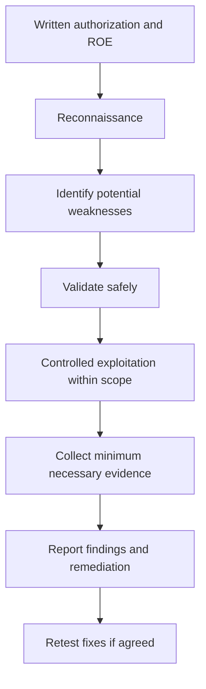

# Penetration Testing

**CompTIA Security+ SY0-701 | Domain 4: Security Operations**

A **penetration test** is an authorized, bounded assessment in which testers attempt to exploit weaknesses to determine whether security controls can be bypassed and what impact may follow. It goes beyond simply listing potential vulnerabilities by validating whether and how weaknesses can be exploited.

Penetration testing must be authorized and carefully scoped. Testing can cause service interruption, data exposure, account lockouts, or other unintended harm if conducted without adequate safeguards.

## 1. Rules of engagement

The **rules of engagement (ROE)** define how the assessment will be conducted. They should be written and approved before testing starts.

Include:
- Purpose, scope, objectives, and success criteria.
- In-scope and out-of-scope networks, systems, applications, and facilities.
- Testing methods allowed or prohibited.
- Dates, time windows, and expected impact.
- Source IP ranges, test accounts, and access details.
- Emergency contacts and stop-testing conditions.
- How sensitive information, credentials, and evidence will be handled.
- Reporting format, severity criteria, and remediation retest expectations.

A compliance requirement may require testing by an independent third party. A clear ROE protects both the organization and the testers by setting mutually understood boundaries.

## 2. Penetration-test process

A common sequence is:
1. Define authorization, scope, and ROE.
2. Perform reconnaissance and map the target environment.
3. Identify and validate weaknesses.
4. Attempt controlled exploitation.
5. Assess privilege escalation and lateral movement where authorized.
6. Determine whether persistence or pivoting can be demonstrated safely.
7. Collect evidence without exceeding the agreed scope.
8. Report impact, evidence, limitations, and remediation recommendations.
9. Retest fixes where included in the engagement.

- **Initial exploitation:** use a weakness to gain an initial foothold.
- **Lateral movement:** move from one system or account to another.
- **Persistence:** test whether access could be retained after ordinary interruptions; in real engagements, avoid leaving harmful mechanisms behind.
- **Pivoting:** use an authorized compromised system or access path to examine another in-scope area.

The purpose is not to cause damage, steal unnecessary data, or prove every conceivable attack chain. Use the least intrusive approach that provides sufficient evidence.

## 3. Responsible disclosure

When a real vulnerability is found, responsible or coordinated disclosure gives the affected organization an opportunity to validate and remediate it before broader publication. Programs may include:
- Coordinated disclosure timelines.
- A bug-bounty program with defined eligibility and scope.
- A private report with reproducible technical evidence.
- A controlled public advisory after coordination.

Never perform unauthorized testing against a real system. Follow the owner's rules and applicable law.

## Further reading
- [NIST SP 800-115 — Technical Guide to Information Security Testing and Assessment](https://csrc.nist.gov/pubs/sp/800/115/final)
- [Professor Messer — Penetration Testing](https://www.professormesser.com/security-plus/sy0-701/sy0-701-video/penetration-testing-sy0-701/)
