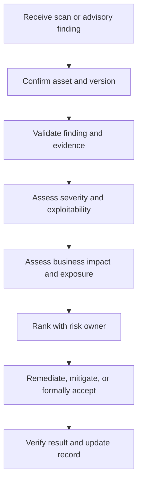

# Analyzing Vulnerabilities

**CompTIA Security+ SY0-701 | Domain 4: Security Operations**

A vulnerability finding is useful only when it is understood, validated, prioritized, and acted on. Analysis combines technical evidence with asset value, business impact, exposure, threat likelihood, and available mitigations.

## 1. False positives and false negatives

- **False positive:** a tool reports a vulnerability that is not actually present or not applicable to the system.
- **False negative:** a real vulnerability exists but the tool fails to detect it.

Common causes include outdated scan signatures, missing credentials, unreachable systems, incorrect asset identification, unsupported checks, custom configurations, and incomplete scan coverage. Validate findings before taking disruptive action, but do not dismiss uncertain findings without investigation.

## 2. Vulnerability classification and scoring

A vulnerability may be identified by a public identifier such as a **CVE**. The **Common Vulnerability Scoring System (CVSS)** provides a structured severity score, commonly represented on a 0.0–10.0 scale in CVSS v3.x and v4.0. CVSS is not the same as an organization's final business risk ranking.

Use:
- The CVE record and vendor advisory.
- CVSS details and vector, not only the number.
- Evidence that the affected product/version is present.
- Whether exploitation is known or occurring.
- Asset criticality and exposure.
- Required privileges and user interaction.
- Available mitigations and compensating controls.
- Dependencies and the consequences of patching or not patching.

Scanner databases should be kept current. A scanner may report different results when its detection content, credentials, or scope changes.

## 3. Prioritizing vulnerabilities

Not every finding needs to be fixed in the same order. Higher priority often goes to a vulnerability that:
- Affects a critical asset or sensitive data.
- Is reachable from the Internet or other untrusted networks.
- Has a reliable exploit or is actively exploited.
- Could enable privilege escalation, sensitive data access, or broad service disruption.
- Has no effective compensating control.

Environmental context matters. For example, an outage that temporarily reduces access to a low-criticality service may have a different impact from a vulnerability that permits a full system compromise. A buffer overflow that leads to code execution may be more serious than one that causes only a recoverable crash, depending on the system and exploitability.

## 4. CVE, CVSS, and contextual analysis

- **CVE:** provides a common identifier for a publicly disclosed vulnerability.
- **CVSS:** describes technical severity using defined metrics.
- **Vendor advisories:** describe affected products, fixes, and mitigations.
- **Environmental/business analysis:** decides how urgently the organization should act.

Use sources such as the National Vulnerability Database (NVD), vendor security advisories, and relevant threat intelligence. Not every vulnerability has a CVE, and absence of a CVE does not mean the software is secure.

## Prioritization workflow

## Further reading
- [Professor Messer — Analyzing Vulnerabilities](https://www.professormesser.com/security-plus/sy0-701/sy0-701-video/analyzing-vulnerabilities-sy0-701/)
- [NIST National Vulnerability Database](https://nvd.nist.gov/)
- [FIRST — CVSS v4.0 Specification](https://www.first.org/cvss/v4.0/specification-document)
- [NIST SP 800-30 Rev. 1 — Guide for Conducting Risk Assessments](https://csrc.nist.gov/pubs/sp/800/30/r1/final)
