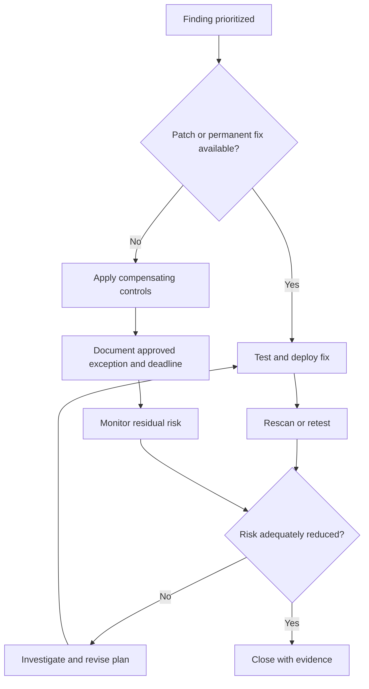

# Vulnerability Remediation

**CompTIA Security+ SY0-701 | Domain 4: Security Operations**

Vulnerability remediation reduces the likelihood or impact of a known weakness. Removing the vulnerability is usually the preferred outcome, but the appropriate action depends on the system, available patches, testing requirements, business constraints, and residual risk.

## 1. Patching

Patching is a common mitigation technique. A patch may fix a vulnerability, correct a defect, or change behavior.

A patching program should:
- Track vendor advisories and newly discovered vulnerabilities.
- Rank updates according to risk and business impact.
- Test important changes where practical.
- Deploy critical fixes promptly under an approved emergency process.
- Record assets, version changes, dates, failures, and exceptions.
- Validate that the patch was applied and the vulnerability is no longer present.

Patching is an ongoing process. A system that was secure yesterday may become vulnerable when a new flaw is disclosed or when a new affected component is introduced.

## 2. Cybersecurity insurance

Cybersecurity insurance can transfer some financial risk associated with a covered event. It does **not** remove the vulnerability or replace security controls. Coverage is limited by policy terms, exclusions, limits, and required safeguards. Insurers may require evidence of controls such as multifactor authentication, backups, and vulnerability management.

## 3. Segmentation and isolation

**Segmentation** divides networks or systems into areas with controlled communication paths. It can limit the scope of an exploit or help protect systems that cannot immediately be patched.

Possible compensating actions:
- Isolate an affected device from the Internet or other systems.
- Restrict traffic to approved sources and destinations.
- Place a vulnerable workload in a separate VLAN or security zone.
- Add firewall or application-layer filtering.
- Disable the vulnerable feature or service when feasible.
- Monitor for signs of exploitation.
- Disconnect or air-gap a system only when operationally appropriate.

Segmentation limits paths; it does not fix the underlying flaw. A poorly configured segmentation control may not prevent lateral movement.

## 4. Compensating controls

Compensating controls are alternative safeguards used when a preferred control is unavailable, infeasible, or not immediately effective. Examples include:
- Restricting access to a small set of administrators.
- Blocking vulnerable protocols or exposed ports.
- Increased logging and monitoring.
- Network isolation.
- Application-level filtering.
- Disabling unnecessary functionality.

A compensating control should have a defined owner, purpose, expiry/review date, and evidence that it reduces risk.

## 5. Exceptions and risk acceptance

Not every vulnerability can be patched immediately. A formal exception process should document:
- The affected asset and vulnerability.
- Why normal remediation cannot be completed now.
- Business and security impact.
- Compensating controls.
- The risk owner and required approval.
- An expiry date, remediation plan, and review cadence.

An exception is not the same as proof that the system is secure. It is a recorded decision to operate with known residual risk.

## 6. Validation and reporting

After remediation:
1. Confirm the intended configuration or patch reached the affected assets.
2. Rescan or retest with a reliable method.
3. Review the evidence for successful deployment.
4. Record exceptions and systems that could not be validated.
5. Report remaining exposure and next actions.
6. Repeat monitoring because new vulnerabilities and asset changes continue to occur.

## Further reading
- [Professor Messer — Vulnerability Remediation](https://www.professormesser.com/security-plus/sy0-701/sy0-701-video/vulnerability-remediation-sy0-701/)
- [NIST CSF 2.0](https://csrc.nist.gov/pubs/cswp/29/the-nist-cybersecurity-framework-csf-20/final)
