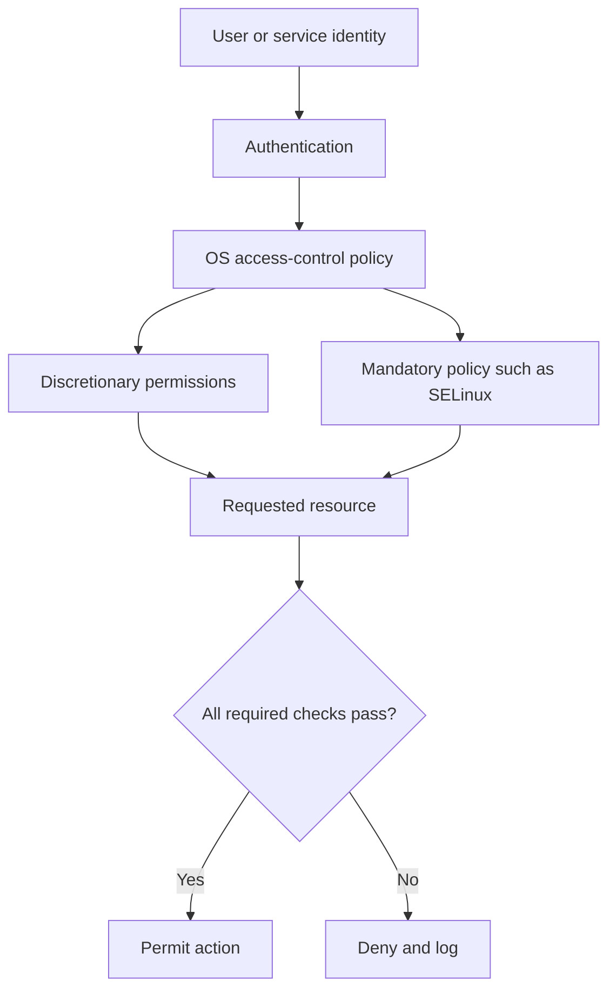

# Operating System Security

**CompTIA Security+ SY0-701 | Domain 4: Security Operations**

Operating-system security relies on identity, permissions, secure configuration, patching, logging, and access controls. Centralized identity and policy-management tools can help organizations manage large numbers of systems consistently.

## 1. Active Directory

**Active Directory Domain Services (AD DS)** is Microsoft's directory service for domain-based Windows environments. It stores directory objects such as users, computers, groups, and other resources. It supports centralized authentication and authorization, allowing organizations to apply policy across many systems.

Important concepts:
- **Domain:** a logical administrative and security boundary.
- **Domain controller:** provides directory and authentication services.
- **Group:** groups users or computers to simplify permission assignment.
- **Group Policy:** centrally applies supported configuration and security settings to users and computers.
- **Directory object:** a record representing an identity or resource.

AD DS does not replace all local controls, and not all Windows systems necessarily belong to the same domain. Organizations should protect privileged accounts, review group membership, monitor changes, and maintain resilient domain controllers.

## 2. Group Policy

Group Policy can centrally configure settings such as:
- Password and account policies.
- Security options.
- Login and startup scripts.
- Firewall and other Windows configuration settings.
- Network and application settings supported by policy.

Policies should be tested, documented, and scoped carefully. A broad policy can unintentionally disrupt systems or grant excessive access.

## 3. Security-Enhanced Linux (SELinux)

Linux traditionally supports discretionary access control (DAC), where file owners and administrators control many permissions. **SELinux** adds **mandatory access control (MAC)** based on a security policy.

SELinux can restrict what processes may read, write, execute, or interact with, even when ordinary Unix permissions would allow access. For example, a web server process can be confined so a compromise does not automatically grant unrestricted access to unrelated files and services.

Key concepts:
- **Policy:** defines permitted interactions.
- **Security context/label:** associates an object or process with a security identity.
- **Enforcing mode:** policy violations are blocked and logged.
- **Permissive mode:** violations are logged but not blocked; it is useful for certain diagnostics, not as a normal high-security operating mode.

SELinux is not a substitute for patching, least privilege, service hardening, or log review.

## 4. Defense-in-depth practices

- Keep the OS and applications updated.
- Remove unused services and packages.
- Use unique user accounts and least privilege.
- Restrict direct administrator/root use and protect privileged credentials.
- Apply central configuration policies where available.
- Enable and review security logs.
- Use encryption and endpoint protection.
- Back up critical configuration and test recovery.
- Validate changes and monitor policy drift.

## Example access-control relationship

## Further reading
- [Microsoft Learn — Active Directory Domain Services](https://learn.microsoft.com/windows-server/identity/ad-ds/)
- [SELinux Project](https://selinuxproject.org/page/Main_Page)
- [NIST SP 800-53 Rev. 5 — Security and Privacy Controls](https://csrc.nist.gov/pubs/sp/800/53/r5/upd1/final)
