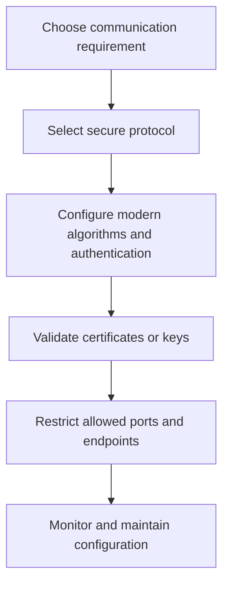

# Secure Protocols

**CompTIA Security+ SY0-701 | Secure network communications**

A secure protocol protects some combination of confidentiality, integrity, authentication, and replay resistance. Protocol choice should be based on the required security properties, supported implementations, configuration, and threat model.

Choosing a familiar port number does not itself make a protocol secure. Encryption can also fail to protect traffic if certificates are not validated, obsolete algorithms are enabled, keys are mishandled, or one side is compromised.

## Common secure alternatives

| Purpose | Prefer | Avoid or limit | Notes |
|---|---|---|---|
| Web traffic | HTTPS using properly configured TLS | Plain HTTP for sensitive sessions | Validate server certificates and protect the entire session |
| Remote shell/administration | SSH | Telnet | SSH encrypts and authenticates the remote connection |
| File transfer | SFTP or SCP over SSH; FTPS where appropriate | Plain FTP for sensitive data | SFTP is an SSH subsystem; FTPS is FTP protected by TLS; they are different protocols |
| Wireless LAN | WPA3, or securely configured WPA2 if necessary | Open or obsolete weak security | Use enterprise authentication for managed environments where appropriate |
| Remote network access | Properly configured VPN using modern cryptography | Unencrypted remote access | VPNs need secure endpoints and access control |
| Network device monitoring | SNMPv3 with authentication and privacy | SNMPv1/v2c community strings on untrusted networks | Configure least privilege and protected management access |
| Email transport | SMTP protected by correctly configured TLS; domain email authentication | Unprotected legacy transmission for sensitive content | Transport encryption is different from verifying the sender domain |

## Protocol and port selection

Use ports required by the secure protocol and the organization's design. A secure protocol may use a well-known port, but port filtering is not a complete security strategy. Restrict management services to approved networks, remove unused services, and monitor unexpected listeners.

## Transport and application protection

Security can be applied at multiple layers:
- **Link layer:** for example, Wi-Fi encryption protects a wireless link.
- **Network layer:** IPsec can protect IP traffic between endpoints or networks.
- **Transport/application layer:** TLS protects application communication such as HTTPS.
- **Tunnel:** a VPN can protect traffic between a client and a remote gateway.

These controls can complement one another. Wi-Fi encryption does not protect traffic after it leaves the wireless network; HTTPS continues to protect traffic to the web endpoint, assuming certificate validation and the endpoint itself are trustworthy.

## Good operational practice

1. Select protocols that meet the business requirement and current security guidance.
2. Disable obsolete versions and weak cipher suites.
3. Validate certificates and host identities.
4. Protect keys and administrator credentials.
5. Restrict management interfaces to necessary sources.
6. Monitor for plaintext protocols and unexpected connection patterns.
7. Review configuration as standards and vendor support change.

## Further reading
- [NIST Computer Security Resource Center](https://csrc.nist.gov/)
- [IETF RFC Editor](https://www.rfc-editor.org/)
