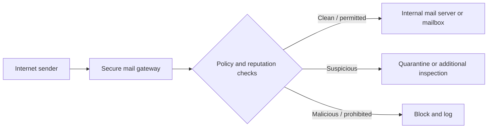
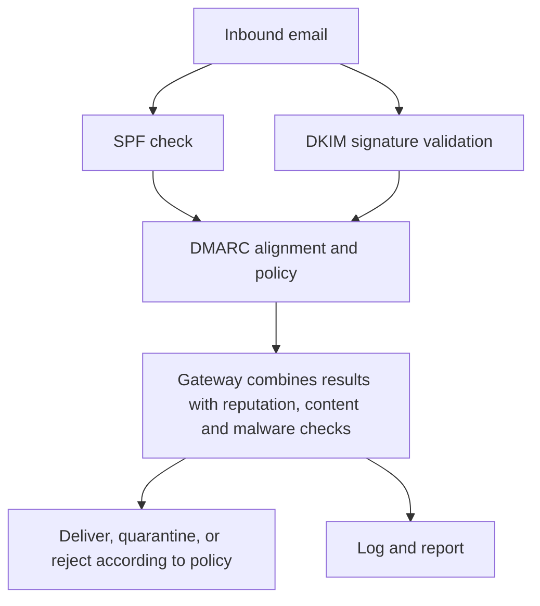

# Email Security: Secure Mail Gateways, SPF, DKIM, and DMARC

**CompTIA Security+ SY0-701 | Domain 4: Security Operations**

Email is a common delivery path for phishing, spoofing, malicious links, and attachments. Email security combines filtering with domain-level authentication and reporting. No single mechanism eliminates all phishing.

## 1. Secure mail gateway

A **secure email gateway** evaluates inbound and/or outbound mail. It may be a cloud service or an on-premises system, often placed between the Internet and internal mail servers or mailboxes.

Typical functions include:
- Spam and phishing detection.
- Malware and attachment analysis.
- URL reputation checking and link analysis.
- Sender/domain checks.
- Policy enforcement and quarantine.
- Logging, reporting, and alerting.

A simplified message flow:

## 2. Sender Policy Framework (SPF)

**SPF** allows a domain owner to publish, in DNS, which mail servers are authorized to send mail using that domain in the SMTP envelope identity. Receiving systems can compare the sending host against that policy.

SPF limitations:
- A passing SPF result does not prove that the visible `From:` address is legitimate.
- Forwarding can complicate SPF evaluation.
- SPF is one signal and should be combined with DKIM, DMARC, filtering, and other analysis.

## 3. DomainKeys Identified Mail (DKIM)

**DKIM** adds a cryptographic signature to selected message headers and the message body. The signing domain publishes a public key in DNS; receiving systems use it to verify the signature and determine whether the signed content changed after signing.

A DKIM pass:
- Supports message integrity for the signed content.
- Shows that a domain controlling the signing key signed the message.
- Does not prove that the sender is trustworthy or that the content is benign.

## 4. Domain-based Message Authentication, Reporting and Conformance (DMARC)

**DMARC** builds on SPF and DKIM. It allows the domain owner to publish a policy and receive reports. DMARC checks alignment between the domain visible to the user and the domain authenticated by SPF and/or DKIM.

Common policy values:
- `p=none`: request monitoring/reporting without asking receivers to quarantine or reject solely under the DMARC policy.
- `p=quarantine`: request that failing messages be treated as suspicious, often delivered to spam/quarantine.
- `p=reject`: request that failing messages be rejected.

The actual disposition depends on receiver implementation and local policy. Deploying strict policies should be preceded by inventorying legitimate senders and carefully monitoring reports.

## How these mechanisms work together

## 5. Spoofing and operational monitoring

Spoofing attempts often impersonate an executive, supplier, bank, or trusted service. A reputable sender should publish and maintain appropriate email-authentication records, but receivers should still inspect:
- Sender and reply-to domain.
- SPF/DKIM/DMARC results and alignment.
- Display-name inconsistencies.
- Links, attachments, and unusual requests.
- Unexpected payment or credential requests.

Security teams should monitor gateway detections, quarantine trends, authentication outcomes, user reports, and DMARC aggregate data. Reporting helps identify legitimate senders that need configuration fixes as well as ongoing spoofing attempts.

## Further reading
- [RFC 7208 — Sender Policy Framework (SPF)](https://www.rfc-editor.org/rfc/rfc7208)
- [RFC 6376 — DomainKeys Identified Mail (DKIM)](https://www.rfc-editor.org/rfc/rfc6376)
- [RFC 7489 — DMARC](https://www.rfc-editor.org/rfc/rfc7489)
