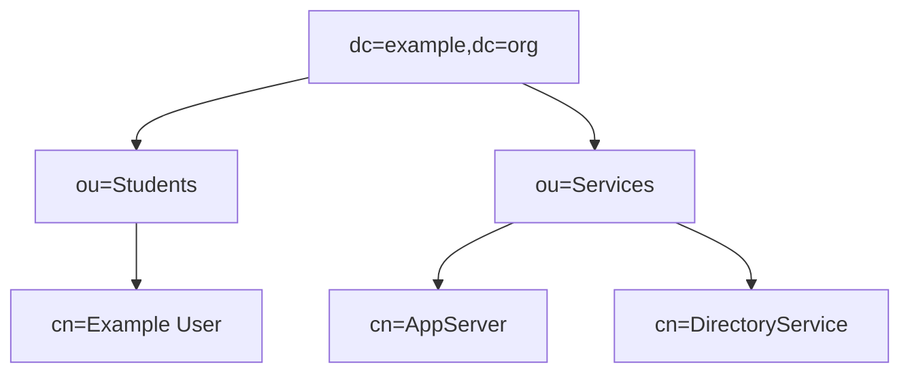
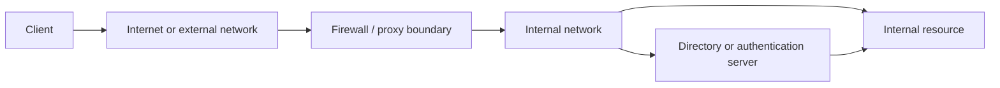
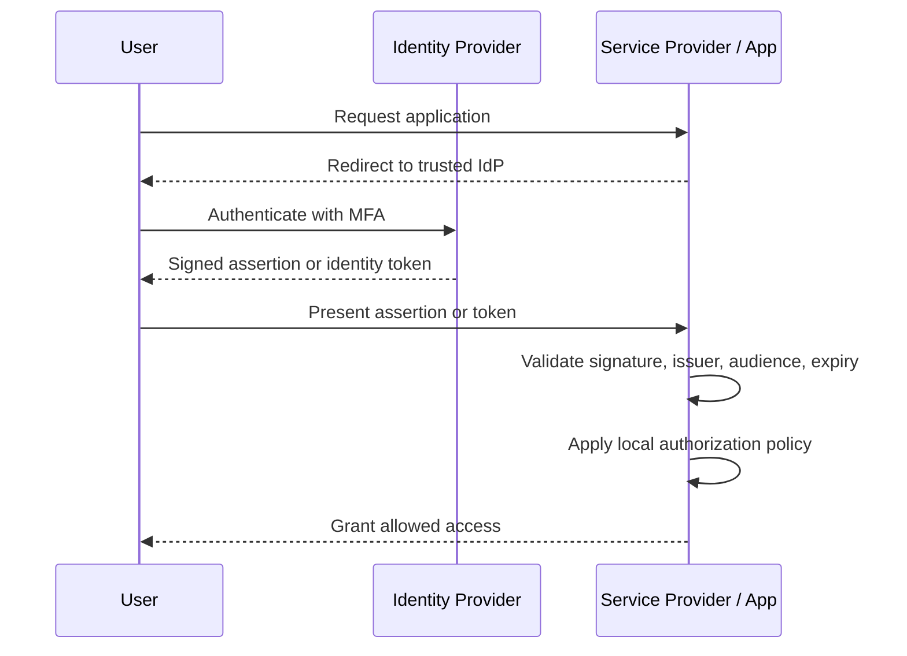
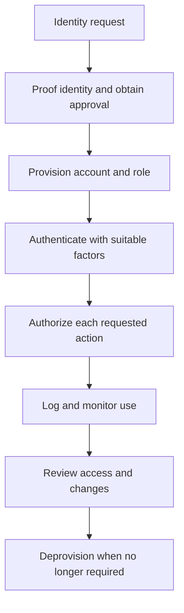

# Identity and Access Management (IAM)

**CompTIA Security+ SY0-701 | Identity, authentication, authorization, and access control**

**Identity and Access Management (IAM)** manages digital identities and ensures users, devices, and services receive only the access they need. It joins identity proofing, account lifecycle processes, authentication, authorization, access reviews, and monitoring.

## 1. Identity lifecycle and provisioning

**Provisioning** creates and configures accounts and permissions. **Deprovisioning** disables or removes access when it is no longer required, for example when an employee leaves, changes jobs, or a contractor engagement ends.

A robust process:
- Creates accounts only after an approved request.
- Assigns a unique identity and appropriate attributes.
- Grants access through approved roles or groups.
- Records who approved and implemented the access.
- Reviews privileges when duties change.
- Disables access promptly at termination.
- Removes tokens, certificates, devices, and other credentials when appropriate.
- Retains audit records according to policy.

An initial review should prevent an account from receiving excessive access at creation. **Identity governance** tracks who has access to which resources, why access is held, who approved it, and whether it remains appropriate.

## 2. Identity proofing, authentication, and authorization

- **Identity proofing:** establishes that a person or entity is who it claims to be during enrollment.
- **Authentication:** validates a claimed identity using an authenticator.
- **Authorization:** determines which actions or resources that authenticated identity may access.
- **Accounting/auditing:** records relevant actions, access, and resource use.

Authentication factors:
- **Something you know:** password, PIN.
- **Something you have:** hardware security key, smart card, registered device.
- **Something you are:** a biometric, such as fingerprint or face recognition.
- **Somewhere you are / contextual signal:** location, network, or device context can help inform a risk decision but is not automatically a separate authentication factor under every framework.
- **Something you do:** behavior such as typing patterns may be used as a contextual biometric, but it has limitations.

Multiple factors must come from different factor categories. Two passwords are still one factor category.

## 3. Multifactor authentication (MFA)

MFA combines two or more independent factor types. It reduces risk from a stolen password, though the strength of the second factor matters.

Examples:
- Password plus a hardware security key.
- Password plus a device-generated one-time code.
- Biometrics used to unlock a cryptographic authenticator.

Not all MFA methods resist phishing equally. A one-time code or push notification can sometimes be relayed or socially engineered. FIDO2/WebAuthn passkeys and security keys can provide phishing-resistant authentication when correctly implemented.

## 4. Password management and passwordless authentication

A password manager can generate and store unique passwords in an encrypted vault. It reduces password reuse and makes strong passwords more practical. Use a strong master password, MFA where available, and a trusted manager.

Modern password guidance favors long passwords/passphrases, blocklisting commonly used or compromised passwords, rate-limiting failed attempts, secure salted password hashing on the server, and MFA. Mandatory periodic changes without evidence of compromise and arbitrary composition requirements can encourage weaker user behavior; follow current organizational and regulatory requirements rather than treating every traditional rule as universally best practice.

**Passwordless authentication** can use cryptographic keys stored in hardware or an authenticator, such as passkeys or security keys. The service verifies a cryptographic response rather than a reusable password. Some implementations use a local PIN or biometric to unlock the key; that local activation does not necessarily mean the server receives the PIN or biometric.

## 5. Just-in-time (JIT) permissions and privileged access

**Just-in-time access** grants elevated privileges only when needed and for a limited period. A secure workflow can require an approved request, strong authentication, a defined scope, automatic expiration, and logging.

Privileged access management may:
- Store privileged credentials in a protected vault.
- Rotate credentials after use or on a schedule.
- Record privileged sessions.
- Require approval or justification.
- Provide temporary accounts or permissions.
- Alert on unusual privileged actions.

No-permanent-access designs reduce standing privileges, but emergency access must also be planned and controlled.

## 6. LDAP and X.500 directories

**LDAP (Lightweight Directory Access Protocol)** is used to query and modify directory information. Directory services may contain users, groups, devices, and other objects.

**X.500** describes directory concepts and a hierarchical information model. A directory information tree (DIT) organizes entries with attributes. Common distinguished-name attributes include:
- `CN`: Common Name.
- `OU`: Organizational Unit.
- `DC`: Domain Component.

An example distinguished name might be:

```text
CN=Example User,OU=Students,DC=example,DC=org
```

The hierarchy helps organize and locate directory objects. The exact naming scheme depends on the directory design.

A directory information tree is hierarchical. A distinguished name is assembled from the entry's relative distinguished name and the names of its parent containers. The following is a generic example; actual attribute values depend on the directory:



### Example: external authentication to internal resources

An enterprise authentication path may place a firewall or proxy between external clients and internal services. Directory services validate identity, and the target service still applies its authorization policy after authentication.



## 7. Single sign-on, SAML, OAuth, and federation

### Single sign-on (SSO)
SSO lets a user authenticate to an identity provider and access multiple connected services without separately entering credentials for each application. The applications must trust the identity provider and apply their own authorization rules. SSO convenience also makes the identity provider a high-value target.

### SAML
**Security Assertion Markup Language (SAML)** is an XML-based standard often used for browser-based enterprise SSO. An identity provider issues a signed assertion that a service provider validates. Correct audience, issuer, signature, expiry, and recipient checks matter.

### OAuth 2.0 and OpenID Connect
**OAuth 2.0** is an authorization framework for delegated access to resources. It lets a client obtain limited authorization to call an API without receiving the user's password. OAuth alone is not an authentication protocol. **OpenID Connect (OIDC)** adds an identity layer on top of OAuth 2.0.

### Federation and interoperability
**Federation** establishes trust between separate identity domains or organizations so a trusted identity provider can provide identity information or access decisions to another service. The parties must agree on protocol, trust anchors, identifiers, claims/attributes, lifecycle management, and incident handling.



## 8. Access-control models

| Model | How access is decided | Typical use / key point |
|---|---|---|
| **DAC — Discretionary Access Control** | Owner or authorized subject controls permissions | Flexible and common on ordinary filesystems |
| **MAC — Mandatory Access Control** | Central policy and security labels control access | More centrally constrained; labels and rules are administered by policy |
| **RBAC — Role-Based Access Control** | Permissions are assigned to roles, and users receive roles | Suitable where job roles map to access needs |
| **Rule-based access control** | Rules decide access from system-defined conditions | May apply to traffic, time, location, or other properties |
| **ABAC — Attribute-Based Access Control** | Evaluates attributes of subject, resource, action, and environment | Fine-grained decisions using multiple attributes |

The least-privilege principle applies across models: grant minimum permissions needed for the role and task. Access should be reviewed as users, responsibilities, and systems change.

### Time-of-day restrictions
Access can be limited to approved hours or a particular time zone, such as allowing a training system to be used only during authorized sessions. Time restrictions are useful only when clocks and time zones are correctly managed and exceptions are handled safely.

## Summary workflow



## Further reading
- [NIST Digital Identity Guidelines, SP 800-63-4](https://pages.nist.gov/800-63-4/)
- [NIST Authenticator Requirements](https://pages.nist.gov/800-63-4/sp800-63b/authenticators/)
- [Microsoft Learn — Active Directory](https://learn.microsoft.com/windows-server/identity/ad-ds/)
- [OAuth 2.0, RFC 6749](https://www.rfc-editor.org/rfc/rfc6749)
- [OpenID Connect](https://openid.net/developers/how-connect-works/)
- [SAML Technical Overview, OASIS](https://www.oasis-open.org/standard/saml/)
