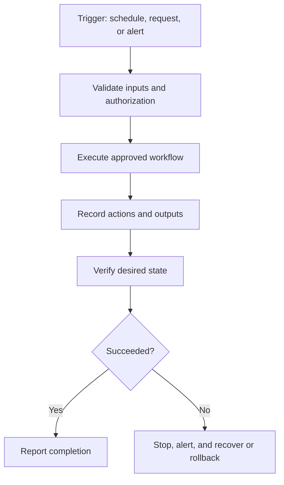

# Scripting and Automation

**CompTIA Security+ SY0-701 | Security operations and operational efficiency**

Scripting and automation use code, workflows, APIs, and scheduled jobs to perform repeatable tasks consistently. Automation is valuable when tasks are frequent, time-sensitive, error-prone, or need to be performed across many systems.

## Benefits

- **Speed:** perform work faster than repeated manual actions.
- **Consistency:** apply the same approved procedure and baseline.
- **Repeatability:** run the same steps on demand or on a schedule.
- **Scalability:** manage more systems without proportionally increasing manual effort.
- **Response time:** collect evidence and execute approved actions quickly.
- **Auditability:** capture logs and results for later review.
- **Employee focus:** free staff from repetitive work to investigate exceptions and solve complex problems.

## Common automation use cases

### User and resource provisioning
A workflow can create an account after an approved HR or ticketing event, assign approved groups, provision required resources, and log each action. Offboarding automation can disable accounts, revoke tokens, remove group membership, and create follow-up tasks.

### Configuration and patching
A script can apply a standard configuration, install approved updates, verify status, and report failures. Updates should be tested and rolled out in stages when appropriate.

### Security monitoring and incident response
Automation can enrich an alert with asset and identity context, create a ticket, notify the right team, or perform a pre-approved containment action. High-impact actions should have appropriate approval and rollback controls.

### Help desk and workflow integration
A service-desk ticket can trigger account reset, software deployment, or access review workflows. APIs can link security tools, ticketing systems, identity services, cloud platforms, and configuration-management tools.

## Common components

- **Trigger:** event, schedule, alert, or approved request that starts the workflow.
- **Logic:** conditions determining which actions should run.
- **Action:** a change, query, notification, or other operation.
- **Credentials/secrets:** tokens or service credentials used to access systems; they must be protected.
- **Logging:** records what ran, when, with what inputs, and with what result.
- **Validation:** checks whether the intended state was reached.
- **Rollback/recovery:** a controlled way to recover from an incorrect action.

## Risks and control measures

Automation can amplify mistakes. A script with an incorrect target list may change thousands of devices or delete critical files quickly. A compromised automation account can also provide broad access.

Controls include:
- Least privilege for scripts and service accounts.
- Protected secret storage; do not hard-code passwords or tokens.
- Code review and version control.
- Test environments and staged rollouts.
- Explicit scope checks and safe defaults.
- Approval for destructive or high-impact actions.
- Logging, alerting, and result validation.
- Timeouts, retries, and duplicate-execution safeguards.
- Documented rollback and emergency stop procedures.

## Further reading
- [NIST Cybersecurity Framework 2.0](https://csrc.nist.gov/pubs/cswp/29/the-nist-cybersecurity-framework-csf-20/final)
- [OWASP Cheat Sheet Series](https://cheatsheetseries.owasp.org/)
