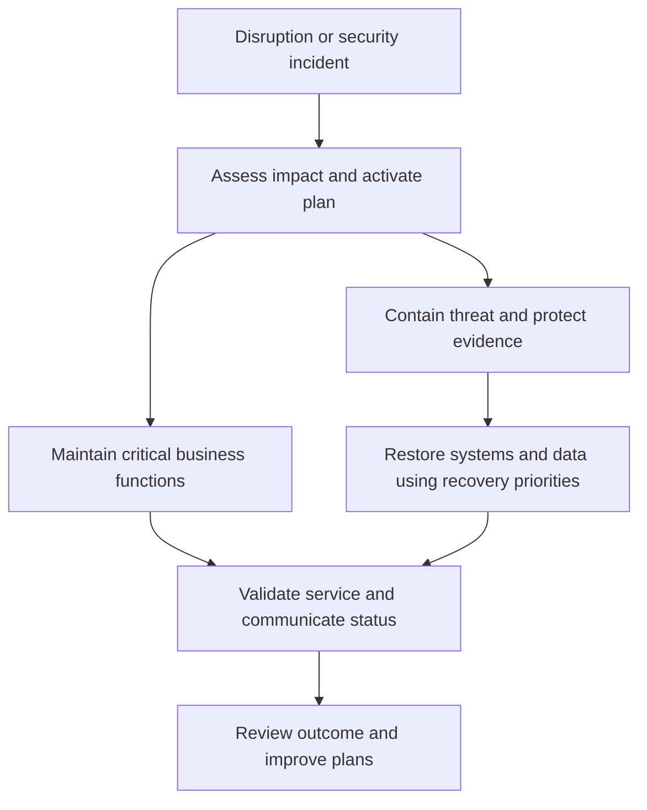

# Security Policies, Business Continuity, and Disaster Recovery

**CompTIA Security+ SY0-701 | Governance and resilience**

## 1. Security policy and standards

A security policy expresses management's rules, goals, responsibilities, and expectations. It helps answer **what must be protected and why**. Policies should be approved, communicated, enforced, and reviewed when business needs, technology, threats, or regulations change.

An **Information Security Policy** provides an overarching direction for security, including roles, acceptable behavior, risk management, incident reporting, access management, and compliance.

An **Acceptable Use Policy (AUP)** defines appropriate and prohibited use of organizational assets such as computers, networks, applications, email, and Internet access. It may explain monitoring, personal-use restrictions, prohibited activities, and consequences for violations. Clear communication and documented enforcement reduce ambiguity.

A useful policy framework typically separates:
- Policy: required outcomes and high-level rules.
- Standard: mandatory, specific requirements used to implement policy.
- Procedure: steps to perform a task.
- Guideline: recommended practice that allows judgment.
- Playbook/runbook: operational instructions for a known event or workflow.

## 2. Business continuity planning

A **Business Continuity Plan (BCP)** describes how critical business functions will continue during and after a disruption. Disruptions can include outages, disasters, cyber incidents, staff shortages, or loss of a key supplier.

A BCP considers:
- Which business services are essential.
- People, facilities, communications, suppliers, and technology required.
- Manual or alternate ways to operate.
- Dependencies and decision-making authority.
- How the plan is activated and who communicates with stakeholders.
- Testing, maintenance, and recovery priorities.

Plans should be documented and tested. A plan that exists only on paper may fail when real people, suppliers, and technical systems are involved.

## 3. Disaster recovery plan

A **Disaster Recovery Plan (DRP)** focuses on restoring IT systems, data, and technology services after a major disruption. It commonly includes backup restoration, alternate infrastructure, system dependencies, recovery order, technical responsibilities, and verification.

BCP and DRP are related but different:
- BCP keeps the business operating or provides an acceptable alternative.
- DRP restores the technology that supports the business.

Both should be coordinated and tested. A technical recovery that restores a server but not its identity, network, application, or data dependencies may not restore the business service.

## 4. Security incidents and continuity

A security incident may include malware delivered through an attachment, a denial-of-service attack, stolen configuration information, compromised credentials, or unauthorized disclosure of data.

Continuity plans should identify which services must keep operating, which actions may isolate a service, who has authority to make emergency decisions, and how recovery will be coordinated with incident response. Evidence preservation and safe containment must be considered alongside availability.

## Further reading
- [Professor Messer — Security Policies](https://www.professormesser.com/security-plus/sy0-701/sy0-701-video/security-policies-sy0-701/)
- [NIST SP 800-34 Rev. 1 — Contingency Planning Guide](https://csrc.nist.gov/pubs/sp/800/34/r1/final)
- [NIST Cybersecurity Framework 2.0](https://csrc.nist.gov/pubs/cswp/29/the-nist-cybersecurity-framework-csf-20/final)
