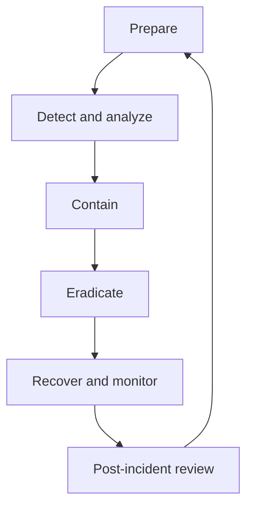
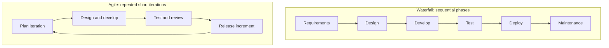
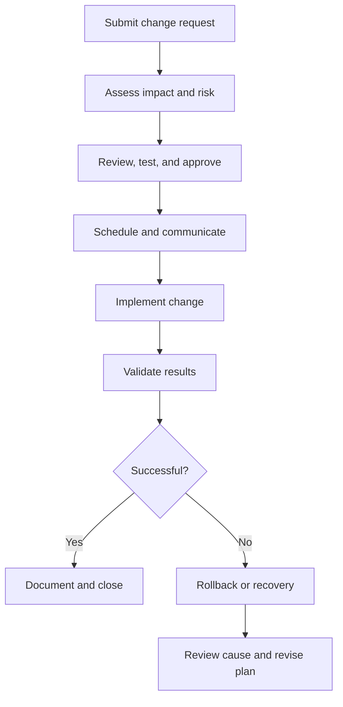

# Incident Response, the SDLC, and Change Management

**CompTIA Security+ SY0-701 | Security program operations**

## 1. Incident response roles

Incident response requires coordinated effort. Depending on the organization, participants may include:
- Incident response team members.
- IT/security management.
- System, network, and application administrators.
- Legal, privacy, compliance, and human-resources representatives.
- Communications or public-relations personnel.
- Business owners and affected users.
- External providers or law enforcement when appropriate.

Roles should be identified in advance. Teams need escalation routes, authority to contain a threat, communication plans, evidence-handling processes, and access to systems needed for response.

## 2. Incident response lifecycle

The traditional NIST incident-handling model includes preparation; detection and analysis; containment, eradication, and recovery; and post-incident activity. Current NIST incident-response guidance integrates incident response into the broader Cybersecurity Framework 2.0 risk-management model.

- **Preparation:** policies, tools, contacts, logging, training, and exercises.
- **Detection and analysis:** identify suspicious activity, validate it, determine scope, and preserve evidence.
- **Containment:** limit damage and prevent spread.
- **Eradication:** remove the cause, malicious artifacts, or unauthorized access.
- **Recovery:** restore systems safely and monitor them for recurrence.
- **Post-incident improvement:** document lessons learned, improve controls, and assign follow-up actions.

## 3. Software Development Life Cycle (SDLC)

The **Software Development Life Cycle (SDLC)** is a framework for planning, building, testing, deploying, and maintaining software. A typical sequence is:
1. Requirements.
2. Design.
3. Development.
4. Testing and review.
5. Deployment.
6. Maintenance.

A framework supports predictable work, security requirements, testing, budgets, and ownership. Security should be included at each stage, rather than only at the end.

### Waterfall and Agile

- **Waterfall:** phases are primarily completed in sequence with formal handoffs. It may suit projects with stable requirements, but late changes can be costly.
- **Agile:** work is delivered iteratively in smaller increments. Feedback and testing occur throughout development, and priorities can be adjusted between iterations.

Neither approach is automatically secure. Security requirements, code review, testing, dependency management, and controlled release must be included.

## 4. Change management

Change management controls changes to systems, applications, configurations, and infrastructure. Enterprise changes can introduce outages, security gaps, and unexpected dependencies.

A formal change request should record:
- What will change and why.
- Systems and users affected.
- Risk and impact assessment.
- Test results and implementation plan.
- Required approvals.
- Maintenance window and communication.
- Backup and rollback plan.
- Post-change verification and documentation.

Emergency changes may need a faster process, but the organization should still document the reason, authority, risks, execution, and follow-up review.

## Further reading
- [Professor Messer — Incident Response](https://www.professormesser.com/security-plus/sy0-701/sy0-701-video/incident-response-sy0-701/)
- [Professor Messer — Change Management](https://www.professormesser.com/security-plus/sy0-701/sy0-701-video/change-management-sy0-701/)
- [Professor Messer — Technical Change Management](https://www.professormesser.com/security-plus/sy0-701/sy0-701-video/technical-change-management-sy0-701/)
- [NIST SP 800-61 Rev. 3 — Incident Response Recommendations](https://csrc.nist.gov/pubs/sp/800/61/r3/final)
- [NIST Secure Software Development Framework, SP 800-218](https://csrc.nist.gov/pubs/sp/800/218/final)
