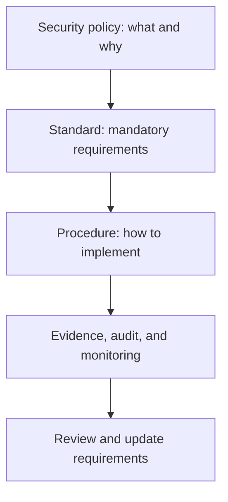

# Security Standards

**CompTIA Security+ SY0-701 | Governance and control implementation**

A security standard defines consistent, specific requirements for systems, processes, and users. Standards translate high-level policy into requirements that can be implemented and evaluated. They reduce ambiguity and help different teams apply compatible controls.

Examples of security-standard areas include:
- Password and authentication requirements.
- Access-control and account-management rules.
- Physical-security requirements.
- Encryption and cryptographic key management.
- Secure network-protocol configuration.
- Logging and monitoring.
- Data classification, handling, and retention.
- Backup, recovery, and change management.

## 1. Password standards

A password standard can define accepted authentication methods, password storage, account-lockout or rate-limiting behavior, password-manager use, recovery procedures, and MFA requirements.

Current guidance favors strong, unique passwords, checking new passwords against commonly used or compromised values, rate-limiting guessing, and storing server-side password verifiers using salted password-hashing schemes designed to resist offline attacks. Mandatory periodic password changes without evidence of compromise and arbitrary composition requirements are not universal modern best practices; standards should follow current authoritative guidance and applicable compliance obligations.

## 2. Access-control standards

Access-control standards specify:
- Which users or roles can access a resource.
- How access is requested, approved, and removed.
- How privileged accounts are controlled.
- When access reviews occur.
- How access is logged.
- What happens when a user changes roles or leaves.

Controls may be based on ACLs, groups, roles, attributes, labels, or rules. Use least privilege and separation of duties where appropriate.

## 3. Physical security standards

A physical-security standard may define requirements for:
- Identification cards, RFID badges, PIN-controlled entry, and visitor checks.
- Biometric locks where appropriate.
- Doors, locks, barriers, fencing, and secured rooms.
- Cameras, surveillance, lighting, alarms, and monitoring.
- Secure handling of equipment and removal of retired hardware.
- Environmental protection and emergency access.

The standard should fit the sensitivity of the facility, threats, and operational needs.

## 4. Encryption standards

Encryption standards specify which algorithms, key sizes, protocols, and key-management processes are permitted for different types of data.

They should distinguish:
- Data at rest.
- Data in transit.
- Data in use and associated access controls.
- Password hashing, which is one-way and not the same as reversible encryption.
- Digital signatures, which support authenticity and integrity rather than confidentiality.

Standards need a process for updating deprecated algorithms and legacy exceptions.

## Policy-to-standard relationship

## Further reading
- [NIST SP 800-53 Rev. 5 — Security and Privacy Controls](https://csrc.nist.gov/pubs/sp/800/53/r5/upd1/final)
- [NIST Digital Identity Guidelines](https://pages.nist.gov/800-63-4/)
