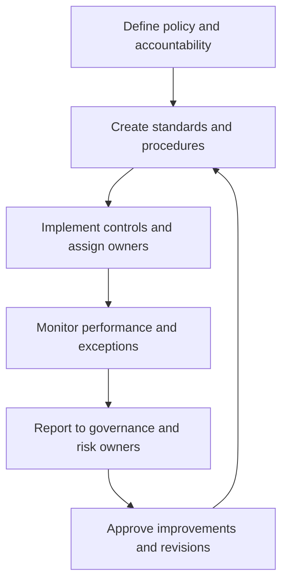

# Security Procedures, Monitoring, and Governance

**CompTIA Security+ SY0-701 | Security program operations**

## 1. Security procedures

A procedure gives repeatable instructions for completing a security task or responding to a situation. Procedures help different staff members reach consistent results and reduce mistakes during stressful events.

Common procedure areas:
- Change management.
- Employee onboarding and offboarding.
- Account provisioning and access removal.
- Asset inventory and secure disposal.
- Incident reporting and evidence preservation.
- Patch deployment and validation.
- Backup restoration and recovery.
- Escalation and approval workflows.

### Onboarding
Onboarding typically creates approved user accounts, assigns role-based access, provides required hardware/software, applies secure configuration, and records training and policy acknowledgement.

### Offboarding
Offboarding should disable or remove access promptly, revoke tokens and credentials, recover assets, transfer required work information, and document completion. The exact order depends on the employee's role, risk, legal requirements, and business continuity needs.

## 2. Playbooks and security orchestration

A **playbook** describes steps to follow during a known event, such as a suspected phishing email or compromised account. Playbooks may be integrated into SOAR (Security Orchestration, Automation, and Response) platforms to combine alerts, enrichment, approvals, and response actions.

A playbook should identify:
- Trigger and scope.
- Required evidence and data sources.
- Decision points and escalation criteria.
- Authorized actions and approval requirements.
- Notifications and recordkeeping.
- Completion criteria and lessons learned.

Automation should not blindly execute destructive actions. Require safeguards for high-impact operations and provide an escalation path when facts are uncertain.

## 3. Monitoring and revision

Security conditions change. Procedures and standards should be reviewed when:
- Systems or applications change.
- New threats or vulnerabilities emerge.
- Incidents expose gaps.
- Compliance requirements change.
- Testing shows the procedure is ineffective.

Ongoing monitoring can include alerts, audits, metrics, exception reports, and review of control effectiveness.

## 4. Governance structures

Governance identifies who directs, approves, monitors, and is accountable for security decisions.

- **Board or governing body:** provides oversight, establishes expectations, and monitors major risks.
- **Committee:** brings relevant subject-matter experts together to evaluate proposals, risks, and performance.
- **Executive and business owners:** accept risk and provide resources within their authority.
- **Security and IT teams:** design, operate, and monitor controls.
- **Audit/compliance functions:** independently assess evidence and report gaps where appropriate.

Organizations may be centralized, decentralized, or hybrid. Centralized governance can improve consistency and consolidate reporting; decentralized structures can respond more locally. A hybrid model commonly establishes organization-wide minimum standards while allowing controlled implementation differences. Government entities may also operate under specific administrative mandates, legal duties, transparency expectations, and political constraints; these can affect who approves a decision and how it is documented.

## Governance workflow

## Further reading
- [Professor Messer — Security Procedures](https://www.professormesser.com/security-plus/sy0-701/sy0-701-video/security-procedures-sy0-701/)
- [NIST Cybersecurity Framework 2.0](https://csrc.nist.gov/pubs/cswp/29/the-nist-cybersecurity-framework-csf-20/final)
- [NIST SP 800-53 Rev. 5](https://csrc.nist.gov/pubs/sp/800/53/r5/upd1/final)
