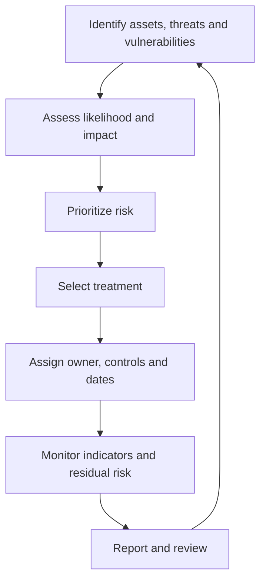

# Risk Management and Risk Analysis

**CompTIA Security+ SY0-701 | Domain 5: Security Program Management and Oversight**

Risk management identifies, assesses, prioritizes, treats, monitors, and communicates risks. The objective is not to eliminate every possible risk; it is to make informed decisions about risk in relation to organizational goals and tolerance.

## 1. Risk identification

Identify assets, threats, vulnerabilities, existing controls, and possible consequences before an event occurs. A risk statement often describes the asset, threat event, weakness or circumstance, likelihood, and impact.

Examples include:
- An exposed remote-management interface may permit unauthorized access.
- An unavailable supplier may interrupt a critical business process.
- Poorly tested updates may cause outages.
- A data-retention weakness may expose personal information.

## 2. Risk assessment

A risk assessment can be performed:
- **At a point in time:** for a new project, acquisition, major change, new vendor, or specific threat.
- **Continuously or periodically:** as part of operations, monitoring, and change management.

One-time and ongoing assessments complement each other. A major change or new threat may require an additional assessment outside the normal schedule.

## 3. Qualitative analysis

Qualitative analysis uses categories such as low, medium, high, or critical. A **risk matrix** compares likelihood and impact to help prioritize attention.

Likelihood may be expressed as rare, unlikely, possible, likely, or almost certain. Impact can consider life safety, property, operations, service availability, legal duties, reputation, and financial loss.

A matrix is a prioritization aid, not a precise mathematical truth. Define the category criteria so different assessors use them consistently.

## 4. Quantitative analysis

Quantitative analysis estimates risk using numerical values. Common terms include:

- **Asset Value (AV):** estimated value of the asset or business function.
- **Exposure Factor (EF):** estimated percentage of the asset value lost from one occurrence, expressed as a decimal.
- **Single Loss Expectancy (SLE):** expected loss from one occurrence.
- **Annualized Rate of Occurrence (ARO):** estimated number of occurrences per year.
- **Annualized Loss Expectancy (ALE):** estimated annual loss.

Formulas:

\[
\text{SLE} = \text{AV} \times \text{EF}
\]

\[
\text{ALE} = \text{SLE} \times \text{ARO}
\]

**Illustrative example:** if an asset is valued at $100,000 and an incident is estimated to cause a 20% loss, SLE is $20,000. If the event is estimated to occur 0.5 times per year, ALE is $10,000 per year. These are estimates; quality depends on the assumptions and data.

Use quantitative analysis where estimates are meaningful. Some risks, such as loss of life or major trust damage, are hard to represent fully in monetary terms.

## 5. Likelihood, appetite, tolerance, and threshold

- **Risk appetite:** the broad amount and type of risk an organization is willing to pursue or retain.
- **Risk tolerance:** the acceptable variation around objectives or appetite.
- **Risk threshold:** a defined point that triggers action or escalation.

A conservative risk posture generally prefers lower exposure; a growth-oriented or expansionary posture may accept greater risk to achieve goals. Neither label replaces explicit assessment and approval.

## 6. Risk register

A risk register records identified risks and how they are managed. Common fields include:
- Risk description and affected assets/processes.
- Threat event, vulnerability, and existing controls.
- Likelihood and impact.
- Inherent and residual risk.
- Owner and accountable decision-maker.
- Treatment strategy and due dates.
- Key risk indicators, threshold, and status.
- Exceptions, evidence, and review history.

## 7. Risk treatment strategies

1. **Avoid:** stop the activity that creates the risk or choose an alternative.
2. **Mitigate:** reduce likelihood or impact using controls.
3. **Transfer/share:** shift some financial or operational exposure through insurance, contracts, or another arrangement. Transferring risk rarely removes all responsibility.
4. **Accept:** retain the risk after informed approval by the authorized owner.
5. **Accept with exception:** document why a control or requirement cannot currently be met, approve the residual risk, define compensating controls, and set an expiration/review date.

Acceptance is a business decision, not proof the risk is harmless. Internal policy or law may prohibit accepting certain risks.

## Risk-management lifecycle

## 8. Risk reporting

Formal reports help senior stakeholders understand critical, emerging, and accepted risks. Reports should be updated regularly and include risk trends, treatment progress, exceptions, changes to exposure, and decisions required. Reporting a risk without a named owner and actionable plan is often insufficient.

## Further reading
- [Professor Messer — Risk Management](https://www.professormesser.com/security-plus/sy0-701/sy0-701-video/risk-management-sy0-701/)
- [Professor Messer — Risk Analysis](https://www.professormesser.com/security-plus/sy0-701/sy0-701-video/risk-analysis-sy0-701/)
- [Professor Messer — Risk Management Strategies](https://www.professormesser.com/security-plus/sy0-701/sy0-701-video/risk-management-strategies-sy0-701/)
- [NIST SP 800-30 Rev. 1 — Guide for Conducting Risk Assessments](https://csrc.nist.gov/pubs/sp/800/30/r1/final)
- [NIST Cybersecurity Framework 2.0](https://csrc.nist.gov/pubs/cswp/29/the-nist-cybersecurity-framework-csf-20/final)
