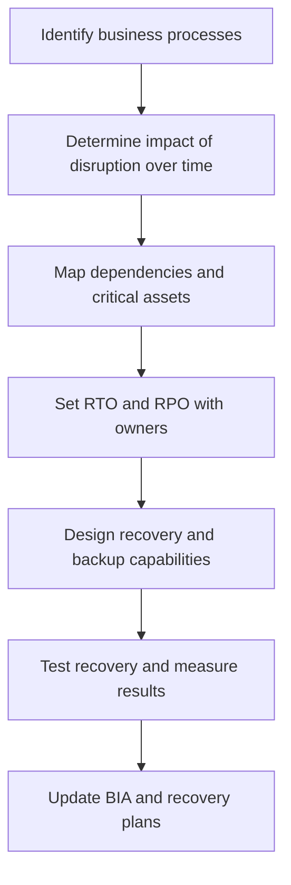

# Business Impact Analysis (BIA)

**CompTIA Security+ SY0-701 | Business resilience and recovery**

A **Business Impact Analysis (BIA)** identifies critical business processes, their dependencies, and the consequences of disruption. It helps an organization prioritize restoration and select recovery objectives that match business requirements.

A BIA considers financial loss, customer impact, legal or regulatory obligations, operational disruption, safety, reputation, and dependencies on people, facilities, suppliers, systems, and data.

## 1. Recovery objectives and metrics

### Recovery Time Objective (RTO)
**RTO** is the target maximum time for restoring a system or business service after disruption before the impact becomes unacceptable. A shorter RTO generally requires more readiness, redundancy, or cost.

### Recovery Point Objective (RPO)
**RPO** describes the point in time to which data must be recovered after a disruption. It determines how much recent data loss, measured as time, may be acceptable. For example, an RPO of 15 minutes means the recovery design should aim to lose no more than approximately 15 minutes of data under the defined failure scenario.

### Mean Time to Repair (MTTR)
**MTTR** is the average time to repair or restore a failed component or service, depending on the organization's measurement definition. It can include diagnosing, fixing, and verifying the issue.

### Mean Time Between Failures (MTBF)
**MTBF** is a reliability measure for a repairable system, representing the average operating time between failures. It is commonly estimated from historical performance and is not a guarantee of when the next failure will occur.

## 2. Recovery priorities

The BIA helps determine which services need faster recovery and how systems depend on one another. A business application may require:
- Identity and access services.
- Network connectivity and DNS.
- Databases and storage.
- Supporting suppliers or cloud platforms.
- Trained staff and communication systems.

A recovery plan should test whether the full service works, not just whether one server is online.

## 3. Use BIA outputs

BIA results inform:
- Recovery sequence and target times.
- Backup frequency and retention.
- Required data-replication capability.
- Alternate facilities or service providers.
- Staffing and emergency procedures.
- Budget and resilience investments.
- Business continuity and disaster recovery plans.

A recovery objective should be approved by the business owner and validated with realistic tests.

## Further reading
- [Professor Messer — Business Impact Analysis](https://www.professormesser.com/security-plus/sy0-701/sy0-701-video/business-impact-analysis-sy0-701/)
- [NIST SP 800-34 Rev. 1 — Contingency Planning Guide](https://csrc.nist.gov/pubs/sp/800/34/r1/final)
- [NIST glossary — Recovery Point Objective](https://csrc.nist.gov/glossary/term/recovery_point_objective)
