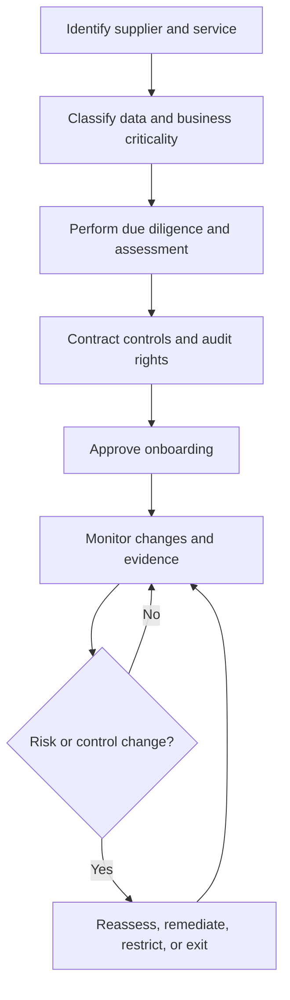

# Third-Party Risk Assessments

**CompTIA Security+ SY0-701 | Domain 5: Supplier and external-service risk**

Organizations rely on vendors, cloud providers, software publishers, contractors, managed service providers, and other external parties. These relationships can improve capability but also introduce risks involving data access, availability, security controls, supply chains, and dependencies.

Third-party risk assessment evaluates the risk before and during a relationship. It should match the supplier's access, the sensitivity of shared data, service criticality, and the potential effect of a compromise.

## 1. Risk assessment and penetration testing

The customer may have limited visibility or control over a supplier's internal security. Assessment methods can include:
- Security questionnaires and evidence requests.
- Independent audit reports or certifications.
- Review of security policies, incident response, backup, and recovery.
- Targeted penetration testing or vulnerability assessments when authorized.
- Review of data processing, access, encryption, retention, and deletion.
- Review of subcontractors and downstream suppliers.

A penetration test against a vendor must have explicit authorization and a defined scope. A customer's contract should not be assumed to authorize testing any infrastructure the vendor happens to use.

## 2. Rules of engagement and scope

When testing a provider, agreement on the rules of engagement may define:
- Test types and methods.
- Scope and in-scope IP ranges or services.
- Testing schedule and rate limits.
- Sensitive information handling.
- Emergency contacts and stop conditions.
- Reporting expectations and evidence sharing.
- Systems or tenants that must not be tested.

Clear rules protect the customer, the vendor, and other customers sharing the vendor's infrastructure.

## 3. Right-to-audit clause

A **right-to-audit clause** grants a customer defined rights to obtain or review evidence that a supplier meets contractual security requirements. It may allow an audit, inspection, or independent attestation under agreed conditions.

The clause should clarify:
- Scope of the audit and access to evidence.
- Frequency and notification requirements.
- Confidentiality and handling of findings.
- Whether independent reports can substitute for direct testing.
- Remediation deadlines and follow-up rights.

The audit right must be defined in the agreement and coordinated with applicable law and shared-environment limits.

## 4. Supply-chain analysis

A product or service can depend on many organizations: developers, software repositories, cloud hosting, hardware manufacturers, distributors, and support providers. A compromise at one point can affect downstream customers.

Supply-chain analysis identifies:
- Suppliers and subcontractors.
- Software and hardware provenance.
- Software update mechanisms.
- Trust relationships and privileged access.
- Concentration risk and single points of failure.
- Processes for notification, patching, and incident response.

The SolarWinds Orion compromise disclosed in 2020 is an example of malicious code introduced through a software update affecting downstream organizations. CISA identified affected Orion versions released between March and June 2020. Roughly 18,000 customers were reported as potentially exposed to the trojanized updates, but installation of an affected update must not be equated with confirmed follow-on exploitation of every customer. The lesson is that trusted supply chains require verification, monitoring, and layered controls.

## 5. Independent assessments and supplier selection

Independent assessments provide an outside perspective and may reveal issues the internal team missed. Supplier due diligence can include:
- Business legitimacy and financial stability.
- Security history, past incidents, and remediation.
- Certifications, audit reports, and technical evidence.
- Legal/regulatory issues and contractual capability.
- Data location, subcontractors, and access practices.
- Conflicts of interest.
- Incident notification and recovery commitments.

## 6. Vendor monitoring

Third-party risk is ongoing. Suppliers can change ownership, staff, architecture, services, controls, or subcontractors after onboarding. Monitoring may include periodic reassessments, incident notices, new vulnerabilities, changes to service scope, audit findings, and key risk indicators.

Questionnaires are one input, not proof on their own. Findings should feed the organization's risk register and vendor decisions.

## Further reading
- [Professor Messer — Third-party Risk Assessment](https://www.professormesser.com/security-plus/sy0-701/sy0-701-video/third-party-risk-assessment-sy0-701/)
- [CISA — Active Exploitation of SolarWinds Software](https://www.cisa.gov/news-events/alerts/2020/12/13/active-exploitation-solarwinds-software)
- [NIST Cybersecurity Framework 2.0](https://csrc.nist.gov/pubs/cswp/29/the-nist-cybersecurity-framework-csf-20/final)
