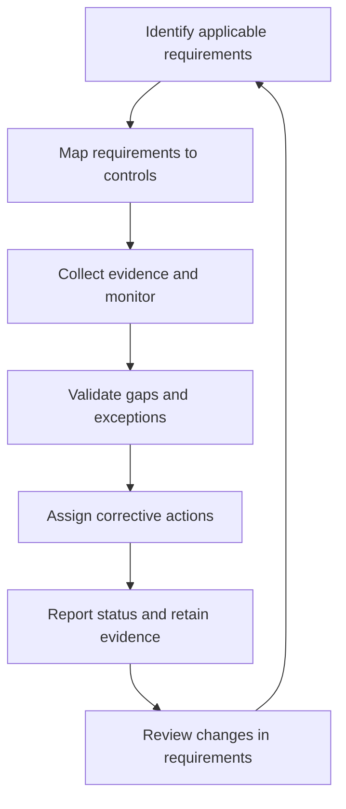

# Security Compliance

**CompTIA Security+ SY0-701 | Domain 5: Governance and oversight**

**Compliance** means meeting applicable laws, regulations, industry requirements, contracts, and internal policies. Compliance defines requirements that an organization must satisfy, but compliance alone does not guarantee that every risk is adequately managed.

## 1. Internal and external compliance

### Internal compliance
Internal compliance checks whether employees, systems, and business processes follow organizational policy. It may involve control testing, reviews, evidence collection, audits, training records, and corrective actions.

### External compliance
External compliance addresses duties imposed by laws, regulators, contracts, or industry programs. Depending on the situation, independent audits, evidence submissions, attestations, or formal reports may be required.

A **Chief Compliance Officer (CCO)** or similar role may coordinate the compliance program in larger organizations. Responsibilities and reporting relationships vary by organization.

## 2. Examples of regulations and standards

Examples that may apply to particular organizations:
- **SOX:** financial reporting and internal-control obligations for covered organizations.
- **HIPAA:** U.S. requirements for applicable health information and covered entities/business associates.
- **GLBA:** requirements relevant to certain U.S. financial institutions and customer information.
- **PCI DSS:** industry payment-card data security requirements for in-scope entities.
- **GDPR:** EU data-protection rules that apply based on their scope.

The applicability of each requirement depends on the organization, activity, data, and jurisdiction. A compliance program should use the current authoritative text and qualified interpretation.

## 3. Consequences of non-compliance

Possible consequences include:
- Financial penalties and legal action.
- Mandatory remediation or increased oversight.
- Loss of licenses, certifications, or business opportunities.
- Contractual consequences.
- Reputational damage and customer loss.
- Increased cost of operations, insurance, or supplier relationships.

Failure to handle a breach transparently or meet notification duties can worsen reputational and legal impact. Public disclosure can also create pressure from customers, regulators, partners, and investors.

**Illustrative case:** The U.S. Department of Justice documented that the 2016 Uber breach involved data associated with approximately 57 million users and drivers, including about 600,000 driver’s-license numbers. Uber did not report the breach to the FTC until roughly a year later; in a separate criminal case, Uber’s former chief security officer was convicted in 2022 for actions related to covering up the breach and was sentenced in 2023. The compliance lesson is that response, notification, and truthful cooperation can carry consequences distinct from the original intrusion.

## 4. Compliance monitoring

Ongoing monitoring can include:
- Reviewing controls and configuration.
- Collecting evidence and audit records.
- Tracking policy exceptions and remediation.
- Reviewing supplier evidence and independent assessments.
- Monitoring regulatory changes.
- Obtaining attestations or acknowledgements where appropriate.
- Compiling reports for compliance owners and management.

Third-party monitoring may be important where a provider hosts data or performs a regulated function. Questionnaires and automated reporting help collect evidence, but high-risk responses should be validated.

## 5. Automated compliance reporting

Automation can gather configuration and control status from multiple systems, identify gaps, and generate reports. Useful reports distinguish:
- Compliant, noncompliant, and unknown status.
- Evidence freshness and coverage.
- Exceptions and compensating controls.
- Findings that require human validation.
- Remediation owner and due date.

Automation is only as reliable as its data sources, definitions, and verification process.

## Further reading
- [Professor Messer — Compliance](https://www.professormesser.com/security-plus/sy0-701/sy0-701-video/compliance-sy0-701/)
- [PCI Security Standards Council](https://www.pcisecuritystandards.org/)
- [U.S. HHS — HIPAA](https://www.hhs.gov/hipaa/)
- [EU GDPR official text](https://eur-lex.europa.eu/eli/reg/2016/679/oj)
- [U.S. Department of Justice — Uber 2016 breach non-prosecution agreement](https://www.justice.gov/usao-ndca/pr/uber-enters-non-prosecution-agreement)
- [U.S. Department of Justice — former Uber CSO sentencing](https://www.justice.gov/usao-ndca/pr/former-chief-security-officer-uber-sentenced-three-years-probation-covering-data)
- [NIST CSF 2.0](https://csrc.nist.gov/pubs/cswp/29/the-nist-cybersecurity-framework-csf-20/final)
