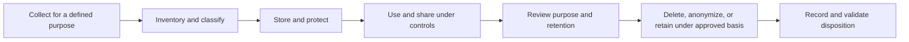

# Privacy, Data Inventory, and Retention

**CompTIA Security+ SY0-701 | Domain 5: Security, privacy, and compliance**

Privacy is the appropriate handling of information about people. Privacy requirements influence what data an organization collects, why it collects it, how it uses or shares it, how long it keeps it, and how individuals can exercise applicable rights.

## 1. Geographic and legal scope

Privacy requirements may apply at local, regional, national, or global levels. Organizations that operate across multiple jurisdictions need to understand which rules apply to which processing activities.

Examples include:
- **GDPR:** a European Union data-protection framework with scope and obligations defined by law.
- **COPPA:** a U.S. law concerning collection of personal information from children under 13 by covered online services and websites.
- Sector-specific or national privacy requirements may apply to certain records or organizations.

Do not assume a requirement applies universally because an organization has customers in a particular country; determine its legal scope with appropriate advice.

## 2. Data subjects and personal data

A **data subject** is an identifiable or identified natural person whose personal data is processed. Personal data may include a name, email address, identifier, location, online identifier, or other information that identifies or can relate to a person, depending on the legal framework.

Individuals may have rights such as access, correction, deletion, objection, or portability where the applicable law provides them. Rights are not unlimited; specific exceptions and procedures may apply.

## 3. Data inventory

A **data inventory** is a documented list of the data an organization manages. A useful inventory includes:
- Data category and sensitivity.
- Business purpose and owner.
- Storage locations, systems, and formats.
- Data subjects or populations represented.
- Users and groups with access.
- Internal and external recipients.
- Processing, transfers, and dependencies.
- Retention period and deletion method.
- Applicable policy, legal, and contract requirements.

Data inventory is a foundation for knowing where sensitive information lives and which controls should protect it. Update it when systems, vendors, purposes, or data flows change.

## 4. Retention and disposal

A **retention policy** defines how long data must be retained and when it should be deleted or anonymized. The organization should balance legal retention, business needs, privacy, security, storage costs, and legal holds.

Excessive retention increases the quantity of information that could be exposed in a breach. Deleting data too early can violate law, contractual requirements, or business needs. Data disposal should be verified and should include relevant copies and backups according to the retention design.

## 5. Internal and external data use

Internal use may include business operations, support, analytics, and security. External use can include sharing with service providers, partners, customers, or public recipients. Each use should have a valid purpose and appropriate safeguards.

Privacy controls may include:
- Data minimization.
- Access controls and least privilege.
- Encryption and secure transfer.
- De-identification or pseudonymization when suitable.
- Audit logs and periodic review.
- Contractual restrictions on processors and third parties.
- Retention and deletion controls.
- Procedures for responding to data-subject requests or incidents.

## Data lifecycle

## Further reading
- [Professor Messer — Privacy](https://www.professormesser.com/security-plus/sy0-701/sy0-701-video/privacy-sy0-701/)
- [GDPR official text](https://eur-lex.europa.eu/eli/reg/2016/679/oj)
- [NIST Privacy Framework](https://www.nist.gov/privacy-framework)
- [U.S. FTC — Children's Privacy (COPPA)](https://www.ftc.gov/legal-library/browse/rules/childrens-online-privacy-protection-rule-coppa)
