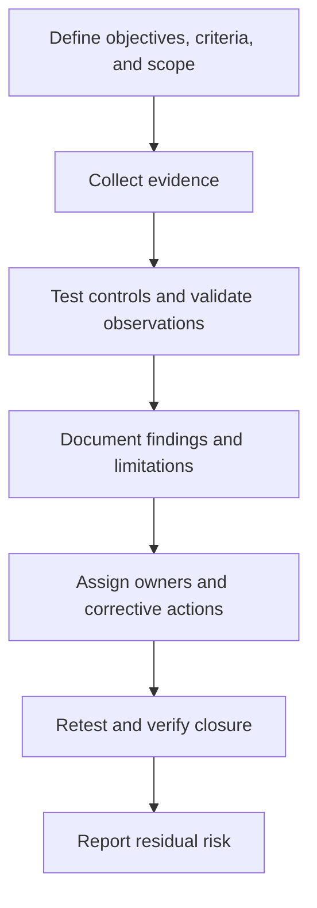

# Audits and Assessments

**CompTIA Security+ SY0-701 | Domain 5: Governance and oversight**

Audits and assessments examine whether controls, processes, systems, and evidence meet defined requirements. They may support security improvement, compliance, customer assurance, internal governance, and risk decisions.

## 1. Cybersecurity audits

A cybersecurity audit may examine:
- IT infrastructure and system configurations.
- Security policies and procedures.
- Account and access-control management.
- Vulnerability handling and patch processes.
- Incident response and recovery.
- Logging, monitoring, and evidence retention.
- Supplier and service-provider controls.
- Whether identified fixes were completed.

An audit is based on criteria, scope, evidence, and sampling. A limited audit cannot guarantee that no weakness exists anywhere in an organization.

## 2. Internal audits

Internal audits are performed by an internal audit function or other authorized internal reviewers. They may:
- Evaluate control effectiveness and compliance.
- Review processes, access, change management, and risk activities.
- Conduct periodic or event-triggered checks.
- Consolidate findings into reports.
- Recommend improvements and track remediation.

Internal reviewers should have suitable independence from the activities being assessed to reduce conflicts of interest.

## 3. External audits and independent assessment

External audits are performed by an independent party. They may be required by regulation, contract, certification, or customer expectations. Their scope and frequency vary.

Evidence can include records, configurations, interviews, samples, test outputs, and technical observations. Some assessments use random or risk-based sampling; the assessor should describe limitations and assumptions.

## 4. Attestation

An **attestation** is a statement or opinion about the accuracy, completeness, or compliance of information or controls, based on defined criteria and evidence. The exact scope of assurance depends on the report type and the work performed.

Do not assume every attestation is a full technical penetration test. Understand what was assessed, which period was covered, what systems were included, and what exceptions were reported.

## 5. Evidence and follow-up

Good audit evidence should be relevant, reliable, timely, and traceable. Findings should include:
- The requirement or control expectation.
- Condition observed and supporting evidence.
- Risk or impact.
- Root cause where known.
- Corrective action and owner.
- Due date and evidence of closure.

Follow-up verifies that fixes were implemented and effective. Unresolved findings, accepted exceptions, and repeat issues should remain visible to the appropriate risk owner.

## Further reading
- [Professor Messer — Audits and Assessments](https://www.professormesser.com/security-plus/sy0-701/sy0-701-video/audits-and-assessments-sy0-701/)
- [NIST SP 800-53 Rev. 5 — Security and Privacy Controls](https://csrc.nist.gov/pubs/sp/800/53/r5/upd1/final)
- [NIST SP 800-115 — Security Testing and Assessment](https://csrc.nist.gov/pubs/sp/800/115/final)
