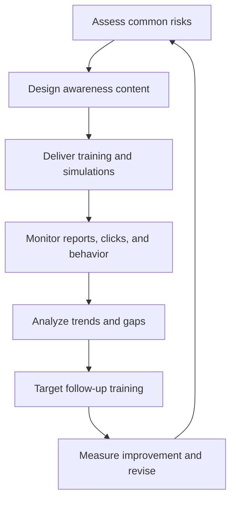

# Security Awareness

**CompTIA Security+ SY0-701 | Domain 5: Security program management**

Security awareness helps people recognize suspicious activity, follow security policies, and report potential incidents. An awareness program should be continuous, measurable, and adapted to the risks and roles of the audience.

## 1. Phishing campaigns

A controlled phishing simulation can measure whether employees recognize suspicious messages and how well email filtering works. Campaigns may report message delivery, opens, clicks, credential submissions, and user reports.

Use a trusted, authorized platform and avoid collecting real passwords. The purpose is education and improvement, not embarrassment or punishment. Metrics should be interpreted carefully: click rates alone do not fully measure security awareness.

Common phishing clues include:
- Unexpected urgency or pressure.
- Sender or reply-to domain mismatch.
- Misspellings, strange phrasing, or inconsistent branding.
- Unexpected links or attachments.
- Requests for passwords, MFA codes, payment, gift cards, or sensitive information.
- Link destinations that do not match the claimed organization.
- Messages that bypass normal business processes.

Users should know how to report suspicious messages and should not be encouraged to open dangerous attachments to examine them.

## 2. Anomalous behavior recognition

Security awareness can teach users and service owners to notice behavior that deviates from normal expectations.

Examples:
- A system unexpectedly changes a configuration or host file.
- Sensitive files are uploaded to an unapproved location.
- A user receives unusual authentication requests.
- A domain or password is changed through an unfamiliar process.
- An application requests permissions it normally does not need.
- An employee is pressured to bypass a required approval.

Behavior may be risky, unexpected, or unintentional. Do not assume every anomaly proves malicious activity; investigate and report according to procedure.

## 3. Reporting and monitoring

Provide simple reporting channels such as a mail-client phishing button, a security mailbox, help-desk ticket, or incident hotline. Users should understand what information to report and what not to do—for example, do not forward suspicious attachments to others or delete evidence unless directed by the response process.

Automated reporting and metrics may track:
- Phishing reports and click rates.
- Response times and recurring events.
- MFA and password-manager adoption.
- Training completion and assessment results.
- Common user confusion or policy violations.
- Areas needing targeted follow-up.

Metrics should inform training content and security decisions rather than exist only for presentation.

## 4. Developing an awareness program

A security-awareness team or assigned function can:
1. Assess the audience and common risks.
2. Define objectives and measures.
3. Create role-specific materials.
4. Deliver training through email, posters, exercises, online modules, or in-person sessions.
5. Monitor completion and outcomes.
6. Provide additional training when a pattern of risk is observed.
7. Revise the program based on incidents and changing threats.

## Further reading
- [Professor Messer — Security Awareness, SY0-701](https://www.professormesser.com/security-plus/sy0-701/sy0-701-video/security-awareness-sy0-701/)
- [CISA — Secure Our World](https://www.cisa.gov/secure-our-world)
