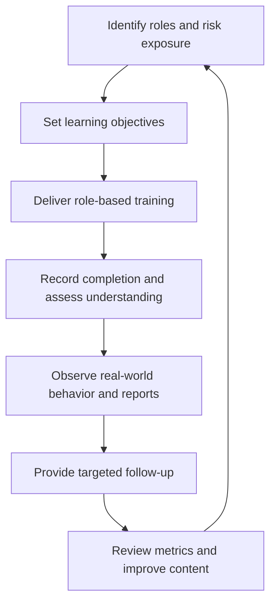

# User Training and Security Education

**CompTIA Security+ SY0-701 | Domain 5: Security awareness and training**

User training gives people the knowledge needed to perform their responsibilities securely. It should occur before access is granted where appropriate, continue as threats and systems change, and be tailored to the user's role and risk exposure.

## 1. Role-specific training

Different audiences need different material:
- Employees need general security practices and relevant policy.
- Administrators need privileged-access, configuration, logging, and change-control training.
- Developers need secure coding, dependency management, secrets protection, and testing practices.
- Help-desk staff need identity verification and secure account-recovery processes.
- Managers need risk, approval, and incident-escalation responsibilities.
- Contractors, suppliers, and partners need security requirements relevant to their access and contract.

Maintain training records, acknowledgements, completion status, and assessment results where required.

## 2. User guidance and handbooks

Policies and handbooks make expectations available for later reference. They may cover:
- Acceptable use of systems and data.
- Password managers, passkeys, and MFA.
- Phishing and social engineering.
- Software installation and update practices.
- Data handling and secure sharing.
- Remote work and public Wi-Fi.
- Lost or stolen device reporting.
- Physical security and visitor processes.
- Removable media and cable/device risks.
- Incident reporting and escalation.

Instructions should be practical and easy to follow. Users should know where to ask for help when a situation does not match the examples.

## 3. Situational awareness

Training should prepare users for realistic situations:
- **Phishing and social engineering:** verify unusual requests, avoid pressure-driven action, and report suspicious content.
- **Travel:** protect devices, use trusted connectivity, and report loss or suspected compromise.
- **Software threats:** install updates from trusted channels, verify software sources, and avoid unapproved tools.
- **Physical threats:** challenge or report unauthorized access according to local policy, secure screens and documents, and protect badges.
- **Insider risks:** handle sensitive data properly and report suspicious or accidental disclosures.
- **Removable media and cables:** avoid unknown USB storage, charging accessories, or devices, and follow approved transfer procedures.
- **Operational security:** minimize exposure of sensitive information and avoid publishing credentials, internal diagrams, or details that aid an attacker.

## 4. Hybrid and remote work

Remote-work guidance should address:
- Approved devices and endpoint protection.
- Strong authentication and least privilege.
- VPN use when required by policy.
- Secure home and public networks.
- Screen privacy and physical protection.
- Storage and sharing of business data.
- Patch management and reporting device loss.
- Separation of personal and corporate data on BYOD devices.

A VPN does not replace endpoint security or safe browsing. Users should still verify destinations, protect credentials, and report suspicious activity.

## 5. Measure training effectiveness

Use more than completion statistics. Useful measures include knowledge assessments, phishing-report rates, repeated risky behavior, incident trends, time to report, and feedback from users. Metrics should respect privacy and be interpreted in context.

## Further reading
- [Professor Messer — User Training, SY0-701](https://www.professormesser.com/security-plus/sy0-701/sy0-701-video/user-training-sy0-701/)
- [CISA — Secure Our World](https://www.cisa.gov/secure-our-world)
